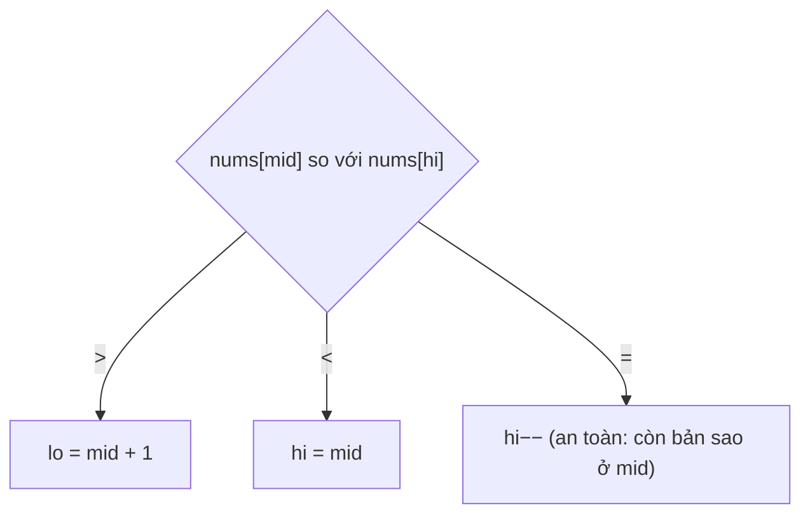

<!-- approaches: Linear scan · Binary search shrinking hi on ties -->
# 154. Find Minimum in Rotated Sorted Array II

**Hard** · Array · Binary Search · [LeetCode ↗](https://leetcode.com/problems/find-minimum-in-rotated-sorted-array-ii/) · Code: [FindMinimumInRotatedSortedArrayII.java](FindMinimumInRotatedSortedArrayII.java) · Tests: [FindMinimumInRotatedSortedArrayIITest.java](FindMinimumInRotatedSortedArrayIITest.java)

## Đề bài

Mảng tăng dần **có thể có phần tử trùng** bị xoay. Tìm phần tử nhỏ nhất, càng ít thao tác càng tốt.

```
[2,2,2,0,1] -> 0      [3,1,3] -> 1
```

## Ý tưởng

> Như bài 153: so `nums[mid]` với `nums[hi]`.
> - `>` → điểm gãy (nhỏ nhất) ở **bên phải** `mid` → `lo = mid + 1`.
> - `<` → `mid … hi` tăng dần → nhỏ nhất ở `mid` hoặc **bên trái** → `hi = mid`.
> - `=` → **không phân biệt được** (ví dụ `[3, 1, 3, 3, 3]` và `[3, 3, 3, 1, 3]` đều có `nums[mid] = nums[hi]`). Nhưng `nums[hi]` có một bản sao ở `mid`, nên **bỏ `hi`** (`hi−−`) chắc chắn không mất giá trị nhỏ nhất.



`[3, 3, 1, 3]`:

| lo | hi | mid | so sánh | |
|---|---|---|---|---|
| 0 | 3 | 1 | 3 = 3 | hi = 2 |
| 0 | 2 | 1 | 3 > 1 | lo = 2 |
| 2 | 2 | | | → **1** |

## Cách 1 — Duyệt tuyến tính `O(n)`

## Cách 2 — Nhị phân, gặp bằng thì `hi−−` ⭐

Trung bình `O(log n)`, nhưng **xấu nhất `O(n)`** (ví dụ toàn số bằng nhau trừ một số) — và không có thuật toán nào tốt hơn cho trường hợp xấu nhất, vì phải nhìn từng phần tử mới thấy được số khác biệt. Người phỏng vấn hay hỏi đúng điều này.

## Bài liên quan

153 Find Minimum in Rotated Sorted Array · 81 Search in Rotated Sorted Array II · 33 Search in Rotated Sorted Array.
