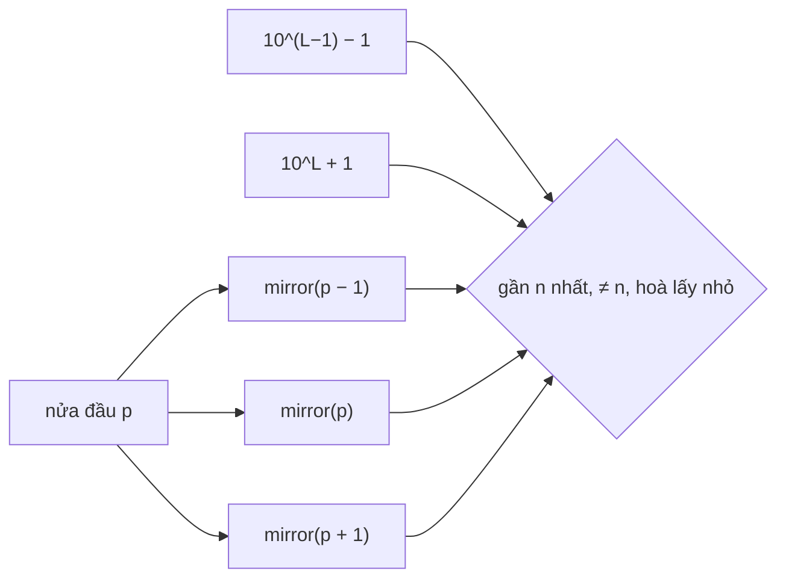

<!-- approaches: Five candidates: mirror of prefix - 1, prefix, prefix + 1, and the two length edges -->
# 564. Find the Closest Palindrome

**Hard** · Math · String · [LeetCode ↗](https://leetcode.com/problems/find-the-closest-palindrome/) · Code: [FindTheClosestPalindrome.java](FindTheClosestPalindrome.java) · Tests: [FindTheClosestPalindromeTest.java](FindTheClosestPalindromeTest.java)

## Đề bài

`n` là số nguyên dạng chuỗi (tới 18 chữ số). Tìm số **đối xứng gần nhất**, không tính chính `n`; hoà thì lấy số nhỏ hơn.

```
"123" -> "121"     "99" -> "101"     "10" -> "9"     "11" -> "9"
```

## Ý tưởng — chỉ có 5 ứng viên

> Số đối xứng được quyết định hoàn toàn bởi **nửa đầu** của nó. Muốn gần `n` nhất thì giữ nửa đầu càng giống `n` càng tốt:
> - lấy **nửa đầu** của `n`, thử `−1`, `0`, `+1`, rồi **lật gương** ra nửa sau → 3 ứng viên;
> - khi số chữ số thay đổi, chỉ có hai số đối xứng sát biên: **`99…9`** (ngắn hơn một chữ số) và **`100…001`** (dài hơn một chữ số).
> Chọn ứng viên gần nhất, khác `n`.

`n = 12345`, nửa đầu `123`:

| ứng viên | số |
|---|---|
| 122 → lật | 12221 |
| 123 → lật | **12321** |
| 124 → lật | 12421 |
| 9999 | 9999 |
| 100001 | 100001 |



## Lời giải `O(L)` ⭐

Các ca biên: `"1"` → `"0"`; `"10"` → `"9"` (ứng viên `99…9`); `"99"` → `"101"` (ứng viên `100…01`); `"11"` → `"9"` (bản thân là đối xứng nên bị loại). Test so với vét cạn cho mọi `n ≤ 30 000`.

## Bài liên quan

9 Palindrome Number · 906 Super Palindromes · 2217 Find Palindrome With Fixed Length · 866 Prime Palindrome.
