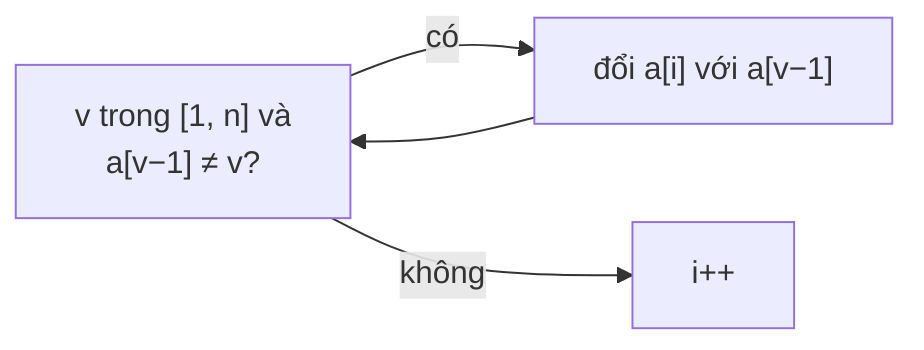

<!-- approaches: Hash set · Cyclic sort (place each value at index value - 1) · Mark by negation -->
# 41. First Missing Positive

**Hard** · Array · Hash Table · [LeetCode ↗](https://leetcode.com/problems/first-missing-positive/) · Code: [FirstMissingPositive.java](FirstMissingPositive.java) · Tests: [FirstMissingPositiveTest.java](FirstMissingPositiveTest.java)

## Đề bài

Tìm **số nguyên dương nhỏ nhất không có** trong mảng chưa sắp xếp, với `O(n)` thời gian và `O(1)` bộ nhớ phụ.

```
[3,4,-1,1] -> 2      [7,8,9,11,12] -> 1      [1,2,0] -> 3
```

## Ý tưởng

> Mảng dài `n` chứa tối đa `n` số dương khác nhau → đáp án luôn nằm trong **`1 … n + 1`**. Chỉ quan tâm các giá trị `1…n`; số âm, số 0, số `> n` là "rác".
> Không có bộ nhớ phụ → dùng **chính mảng làm bảng đánh dấu**: ô `i` dành cho giá trị `i + 1`.

## Cách 1 — HashSet `O(n)` bộ nhớ

## Cách 2 — Cyclic sort ⭐

Đổi chỗ mỗi giá trị `v ∈ [1, n]` về **ô của nó** (`v − 1`), lặp tới khi ô hiện tại chứa đúng giá trị hoặc rác. Sau đó ô đầu tiên `i` có `a[i] ≠ i + 1` cho đáp án `i + 1`.

`[3, 4, −1, 1]`:

| bước | mảng | ghi chú |
|---|---|---|
| i = 0: 3 → ô 2 | −1 4 3 1 | −1 là rác, dừng |
| i = 1: 4 → ô 3 | −1 1 3 4 | 1 → ô 0 |
| | 1 −1 3 4 | −1 là rác, dừng |
| quét | **ô 1 chứa −1** | → đáp án **2** |



Điều kiện `a[a[i] − 1] != a[i]` tránh **lặp vô hạn** khi có giá trị trùng. Mỗi lần đổi chỗ đặt ít nhất một giá trị vào đúng ô → tối đa `n` lần đổi.

## Cách 3 — Đánh dấu bằng dấu âm

Thay rác bằng `n + 1`; với mỗi giá trị `v ≤ n`, đổi `a[v − 1]` thành âm. Ô dương đầu tiên → giá trị bị thiếu (như bài 448).

## Bài liên quan

268 Missing Number · 448 Find All Numbers Disappeared in an Array · 442 Find All Duplicates in an Array · 287 Find the Duplicate Number.
