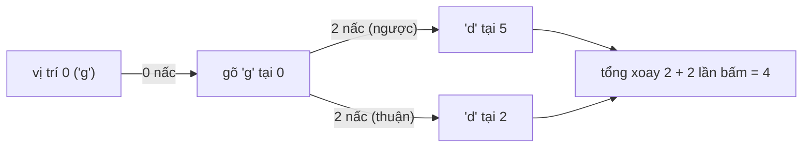

<!-- approaches: Memoized recursion over (ring position, key index) · DP keeping only the positions of each letter -->
# 514. Freedom Trail

**Hard** · String · Dynamic Programming · Depth-First Search · Breadth-First Search · [LeetCode ↗](https://leetcode.com/problems/freedom-trail/) · Code: [FreedomTrail.java](FreedomTrail.java) · Tests: [FreedomTrailTest.java](FreedomTrailTest.java)

## Đề bài

Vòng chữ `ring`, ban đầu `ring[0]` ở vị trí 12 giờ. Để gõ `key`: mỗi bước xoay vòng một nấc (thuận hoặc ngược chiều) cho tới khi chữ cần ở 12 giờ, rồi bấm nút (thêm một bước). Số bước ít nhất?

```
ring = "godding", key = "gd" -> 4   (bấm g: 1; xoay ngược 2 nấc tới 'd': 2; bấm: 1)
```

## Ý tưởng

> Một chữ có thể xuất hiện **nhiều chỗ** trên vòng — chọn chỗ gần nhất **lúc này** chưa chắc tốt cho các chữ sau (tham lam sai). Phải xét mọi lựa chọn → **DP**.
> Trạng thái: `(vị trí đang ở 12 giờ, đã gõ tới chữ thứ k)`. Chuyển: chọn một vị trí `i` chứa `key[k]`, tốn khoảng cách vòng `min(|pos − i|, n − |pos − i|)`.



## Cách 1 — Đệ quy có nhớ `O(k · n²)` ⭐

Số lần bấm luôn bằng `|key|` → tách riêng, DP chỉ tính số nấc xoay.

## Cách 2 — DP theo từng chữ của key

Mỗi chữ chỉ giữ chi phí tại **các vị trí có chữ đó** (thường ít hơn nhiều so với `n`). Chuyển từ tập vị trí của chữ trước sang tập vị trí của chữ sau.

## Bẫy & lưu ý

- Khoảng cách trên **vòng**: phải lấy `min` hai chiều.

## Bài liên quan

1320 Minimum Distance to Type a Word Using Two Fingers · 1048 Longest String Chain · 72 Edit Distance.
