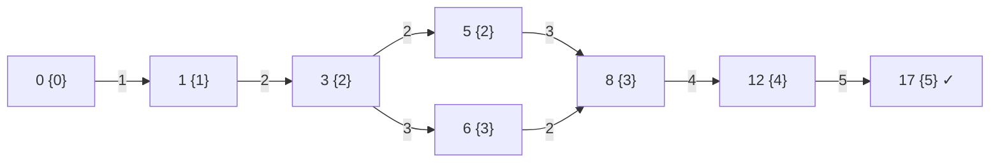

<!-- approaches: DP with a set of jump sizes per stone · Memoized DFS on (stone, last jump) -->
# 403. Frog Jump

**Hard** · Array · Dynamic Programming · [LeetCode ↗](https://leetcode.com/problems/frog-jump/) · Code: [FrogJump.java](FrogJump.java) · Tests: [FrogJumpTest.java](FrogJumpTest.java)

## Đề bài

Các hòn đá ở vị trí tăng dần; ếch đứng trên hòn đầu, bước nhảy đầu tiên dài 1. Nếu bước trước dài `k` thì bước sau phải dài `k−1`, `k` hoặc `k+1` (chỉ nhảy tới). Ếch có tới được hòn cuối không?

```
[0,1,3,5,6,8,12,17] -> true    nhảy 1, 2, 2, 3, 4, 5
```

## Ý tưởng

> Vị trí hiện tại **chưa đủ** để biết bước tiếp theo — còn phụ thuộc vào **độ dài bước vừa nhảy**. Trạng thái = `(hòn đá, bước cuối)`.
> Với mỗi hòn đá, lưu **tập các độ dài bước** có thể đáp xuống nó; từ mỗi độ dài `k`, đẩy `k−1, k, k+1` tới các hòn đá tương ứng (nếu có).



## Cách 1 — Tập bước nhảy cho mỗi hòn đá `O(n²)` ⭐

Mỗi hòn đá có tối đa `n` độ dài bước khác nhau (bước tăng tối đa 1 mỗi lần), nên tổng trạng thái `O(n²)`.

## Cách 2 — DFS có nhớ trên `(chỉ số, bước cuối)`

Ghi nhớ các trạng thái **thất bại** để không thử lại. Thử bước dài trước để thường tới đích nhanh hơn.

## Bẫy & lưu ý

- Bước nhảy phải **dương**: từ bước `k = 1`, lựa chọn `k − 1 = 0` không hợp lệ.
- Tra "có hòn đá ở vị trí `p` không?" bằng `HashMap`.

## Bài liên quan

55 Jump Game · 45 Jump Game II · 1871 Jump Game VII · 1340 Jump Game V.
