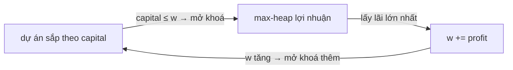

<!-- approaches: Sort by capital + max-heap of profits · Brute force picking the best each round -->
# 502. IPO

**Hard** · Array · Greedy · Sorting · Heap (Priority Queue) · [LeetCode ↗](https://leetcode.com/problems/ipo/) · Code: [IPO.java](IPO.java) · Tests: [IPOTest.java](IPOTest.java)

## Đề bài

Có vốn ban đầu `w`, được làm tối đa `k` dự án (mỗi dự án một lần). Dự án `i` cần vốn tối thiểu `capital[i]` để bắt đầu và cộng thêm `profits[i]` vào vốn khi xong. Vốn cuối cùng lớn nhất?

```
k = 2, w = 0, profits = [1,2,3], capital = [0,1,1] -> 4    (làm dự án 0: vốn 1; rồi dự án 2: vốn 4)
```

## Ý tưởng

> **Tham lam:** mỗi lượt, trong các dự án **đủ vốn** để làm, chọn dự án **lãi nhất**. Lợi nhuận không bao giờ âm, nên vốn chỉ tăng — chọn lãi lớn nhất bây giờ không bao giờ làm mất cơ hội về sau (vốn càng lớn càng mở khoá nhiều dự án).
> Cấu trúc dữ liệu: **sắp xếp theo vốn yêu cầu** (để "mở khoá" dần) + **max-heap theo lợi nhuận** (để chọn nhanh).



| lượt | w | mở khoá thêm | heap | chọn |
|---|---|---|---|---|
| 1 | 0 | dự án 0 (lãi 1) | 1 | 1 → w = 1 |
| 2 | 1 | dự án 1, 2 (lãi 2, 3) | 3 2 | 3 → w = **4** |

## Cách 1 — Sắp xếp + max-heap `O(n log n)` ⭐

Mỗi dự án vào heap đúng một lần.

## Cách 2 — Quét toàn bộ mỗi lượt `O(k·n)`

Cùng chiến lược tham lam, không cần cấu trúc dữ liệu. Dùng làm chuẩn để test (test còn kiểm chứng tính tối ưu của tham lam bằng vét cạn mọi thứ tự).

## Bài liên quan

857 Minimum Cost to Hire K Workers · 1383 Maximum Performance of a Team · 630 Course Schedule III · 295 Find Median from Data Stream.
