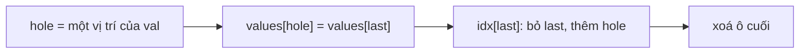

<!-- approaches: ArrayList of values + map value -> set of indices, swap-with-last removal -->
# 381. Insert Delete GetRandom O(1) - Duplicates allowed

**Hard** · Array · Hash Table · Math · Design · [LeetCode ↗](https://leetcode.com/problems/insert-delete-getrandom-o1-duplicates-allowed/) · Code: [InsertDeleteGetRandomO1DuplicatesAllowed.java](InsertDeleteGetRandomO1DuplicatesAllowed.java) · Tests: [InsertDeleteGetRandomO1DuplicatesAllowedTest.java](InsertDeleteGetRandomO1DuplicatesAllowedTest.java)

## Đề bài

Thiết kế `RandomizedCollection` (multiset — cho phép trùng):
- `insert(val)` → `true` nếu trước đó **chưa có** `val`;
- `remove(val)` → xoá **một** lần xuất hiện, trả về có xoá được không;
- `getRandom()` → trả một phần tử với xác suất **tỉ lệ với số lần xuất hiện**.

Tất cả `O(1)` trung bình.

```
insert(1) insert(1) insert(2)   → getRandom() ra 1 với xác suất 2/3
```

## Ý tưởng

> Như bài 380, nhưng một giá trị có **nhiều vị trí**:
> - `values`: ArrayList chứa **từng lần xuất hiện** → chọn chỉ số ngẫu nhiên đều cho đúng phân phối.
> - `idx`: `giá trị → tập các vị trí` trong `values`.
> - **Xoá `O(1)`:** lấy một vị trí bất kỳ của `val`, đưa **phần tử cuối** vào lấp chỗ đó, cập nhật tập vị trí của phần tử cuối, rồi bỏ ô cuối.

```
values = [1, 1, 2]       idx = {1: {0, 1}, 2: {2}}
remove(1): lấy vị trí 0, đưa 2 (ở vị trí 2) vào ô 0
values = [2, 1]          idx = {1: {1}, 2: {0}}
```



## Lời giải ⭐

**Bẫy:** khi vị trí bị xoá **chính là ô cuối** (`hole == last`), không được "dời phần tử cuối vào chính nó" rồi thêm lại vị trí → phải xử lý riêng. Test so với một multiset tham chiếu qua 50 000 thao tác và kiểm tra phân phối của `getRandom`.

## Bài liên quan

380 Insert Delete GetRandom O(1) · 528 Random Pick with Weight · 710 Random Pick with Blacklist · 146 LRU Cache.
