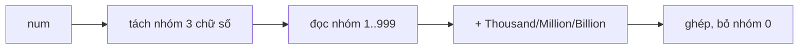

<!-- approaches: Chunks of three digits with scale words -->
# 273. Integer to English Words

**Hard** · Math · String · Recursion · [LeetCode ↗](https://leetcode.com/problems/integer-to-english-words/) · Code: [IntegerToEnglishWords.java](IntegerToEnglishWords.java) · Tests: [IntegerToEnglishWordsTest.java](IntegerToEnglishWordsTest.java)

## Đề bài

Đọc số nguyên không âm thành chữ tiếng Anh.

```
1234567 -> "One Million Two Hundred Thirty Four Thousand Five Hundred Sixty Seven"
```

## Ý tưởng

> Tiếng Anh đọc số theo **nhóm ba chữ số** từ phải sang: mỗi nhóm đọc như một số `1…999`, rồi thêm đơn vị `Thousand`, `Million`, `Billion`.

```
1 | 234 | 567
│    │     └─ Five Hundred Sixty Seven
│    └─ Two Hundred Thirty Four  + Thousand
└─ One                          + Million
```

Đọc một nhóm `1…999`:
- hàng trăm → `X Hundred`;
- `≥ 20` → hàng chục (`Twenty`, `Thirty`…), rồi hàng đơn vị;
- `< 20` → tra bảng (`Eleven`, `Twelve`, …, `Nineteen` không theo quy luật).



## Lời giải ⭐

Bẫy: nhóm bằng 0 bỏ qua hoàn toàn (`1 000 000` → `"One Million"`, không có `"Thousand"`); không được thừa dấu cách; `0` → `"Zero"`. Test quét 2 triệu số kiểm tra dấu cách.

## Bài liên quan

12 Integer to Roman · 13 Roman to Integer · 8 String to Integer (atoi).
