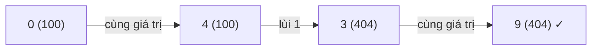

<!-- approaches: BFS over indexes with value groups cleared after use · Bidirectional BFS -->
# 1345. Jump Game IV

**Hard** · Array · Hash Table · Breadth-First Search · [LeetCode ↗](https://leetcode.com/problems/jump-game-iv/) · Code: [JumpGameIV.java](JumpGameIV.java) · Tests: [JumpGameIVTest.java](JumpGameIVTest.java)

## Đề bài

Từ chỉ số `i` được nhảy tới `i + 1`, `i − 1`, hoặc **bất kỳ** `j` có `arr[j] == arr[i]`. Ít bước nhất để từ chỉ số 0 tới chỉ số cuối?

```
[100,-23,-23,404,100,23,23,23,3,404] -> 3    0 → 4 (cùng 100) → 3 → 9 (cùng 404)
```

## Ý tưởng

> "Ít bước nhất", mỗi bước như nhau → **BFS** trên đồ thị các chỉ số.
> Vấn đề: cạnh "cùng giá trị" có thể rất nhiều — mảng toàn số 7 dài `n` có `n²` cạnh. Mẹo: lần đầu dùng các cạnh "cùng giá trị" của một giá trị, **xoá luôn nhóm đó**. Mọi chỉ số trong nhóm đã được đưa vào hàng đợi ở cùng một tầng; duyệt lại nhóm chỉ tốn thời gian mà không tìm thêm được gì.



| tầng | chỉ số mới | nhóm bị xoá |
|---|---|---|
| 0 | 0 | |
| 1 | 4, 1 | 100 |
| 2 | 3, 5, 2 | −23 … |
| 3 | 9 ✓ | 404 |

## Cách 1 — BFS + xoá nhóm sau khi dùng `O(n)` ⭐

Mỗi chỉ số vào hàng đợi một lần; mỗi nhóm giá trị được duyệt một lần → tổng `O(n)`.

## Cách 2 — BFS hai chiều

Mở rộng đồng thời từ đầu và cuối, mỗi lần mở rộng **phía nhỏ hơn**; dừng khi hai phía chạm nhau. Thường thăm ít đỉnh hơn nhiều.

## Bài liên quan

45 Jump Game II · 1306 Jump Game III · 127 Word Ladder (BFS hai chiều) · 815 Bus Routes.
