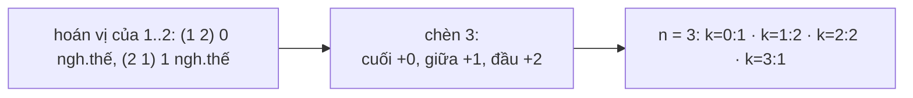

<!-- approaches: DP with prefix sums · DP with the sliding-window recurrence -->
# 629. K Inverse Pairs Array

**Hard** · Dynamic Programming · [LeetCode ↗](https://leetcode.com/problems/k-inverse-pairs-array/) · Code: [KInversePairsArray.java](KInversePairsArray.java) · Tests: [KInversePairsArrayTest.java](KInversePairsArrayTest.java)

## Đề bài

Đếm số hoán vị của `1…n` có **đúng `k` cặp nghịch thế** (`i < j` mà `a[i] > a[j]`), `mod 10⁹+7`.

```
n = 3, k = 1 -> 2    (1 3 2) và (2 1 3)
```

## Ý tưởng

> Dựng hoán vị bằng cách **chèn số lớn nhất** `i` vào một hoán vị của `1…i−1`. Vì `i` lớn hơn mọi số khác, chèn nó vào vị trí cách cuối `t` ô tạo ra **đúng `t`** nghịch thế mới, `t = 0 … i−1`.
> `dp[i][j] = Σ dp[i−1][j − t]` với `t = 0 … min(j, i−1)`.



| j | 0 | 1 | 2 | 3 |
|---|---|---|---|---|
| dp[2][j] | 1 | 1 | 0 | 0 |
| dp[3][j] = tổng tối đa 3 ô liền trước của hàng trên | 1 | 2 | 2 | 1 |

## Cách 1 — DP + tổng tiền tố `O(n·k)` ⭐

Tổng của một **cửa sổ** liên tiếp trên hàng trước → dùng prefix sum, mỗi ô `O(1)`.

## Cách 2 — Công thức truy hồi cửa sổ trượt

`dp[i][j] = dp[i][j−1] + dp[i−1][j] − dp[i−1][j−i]`: dời cửa sổ một ô sang phải = thêm phần tử mới, bỏ phần tử cũ. Nhớ cộng `MOD` trước khi lấy dư để không âm.

## Bài liên quan

629 là bài DP "chèn phần tử lớn nhất" — cùng kỹ thuật với 903 Valid Permutations for DI Sequence; 1866 Number of Ways to Rearrange Sticks With K Sticks Visible; 315 Count of Smaller Numbers After Self (đếm nghịch thế).
