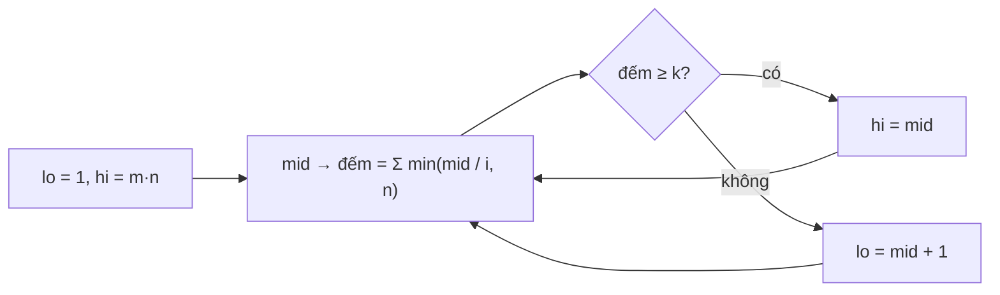

<!-- approaches: Binary search on the value with row counting · Heap of row pointers -->
# 668. Kth Smallest Number in Multiplication Table

**Hard** · Math · Binary Search · [LeetCode ↗](https://leetcode.com/problems/kth-smallest-number-in-multiplication-table/) · Code: [KthSmallestNumberInMultiplicationTable.java](KthSmallestNumberInMultiplicationTable.java) · Tests: [KthSmallestNumberInMultiplicationTableTest.java](KthSmallestNumberInMultiplicationTableTest.java)

## Đề bài

Bảng cửu chương `m × n` có `mat[i][j] = i · j` (đánh số từ 1). Tìm phần tử **nhỏ thứ k**.

```
m = 3, n = 3:    1 2 3
                 2 4 6        sắp xếp: 1 2 2 3 3 4 6 6 9  -> k = 5 là 3
                 3 6 9
```

## Ý tưởng

> Bảng có tới `3·10⁴ × 3·10⁴` phần tử — không thể liệt kê. Nhưng câu hỏi "**có bao nhiêu phần tử `≤ x`?**" trả lời được nhanh: hàng `i` gồm `i, 2i, …, n·i`, nên có `min(x / i, n)` phần tử `≤ x`.
> Số đếm đó **tăng** theo `x` → **tìm kiếm nhị phân trên giá trị**: `x` nhỏ nhất có số đếm `≥ k`.



`m = n = 3, k = 5`:

| mid | đếm (hàng 1, 2, 3) | ≥ 5? |
|---|---|---|
| 5 | 3 + 2 + 1 = 6 | ✓ → hi = 5 |
| 3 | 3 + 1 + 1 = 5 | ✓ → hi = 3 |
| 2 | 2 + 1 + 0 = 3 | ✗ → lo = 3 |

Đáp án **3**. Vì sao `lo` luôn là một giá trị **có thật** trong bảng? Vì nó là giá trị nhỏ nhất làm số đếm đạt `k` — số đếm chỉ tăng tại các giá trị có trong bảng.

## Cách 1 — Nhị phân trên giá trị `O(m log(mn))` ⭐

## Cách 2 — Heap con trỏ mỗi hàng `O(k log m)`

Như 23 Merge k Sorted Lists: mỗi hàng là một danh sách đã sắp xếp. Đúng nhưng chậm khi `k` lên tới `m·n = 9·10⁸`.

## Bài liên quan

378 Kth Smallest Element in a Sorted Matrix · 719 Find K-th Smallest Pair Distance · 786 K-th Smallest Prime Fraction · 410 Split Array Largest Sum.
