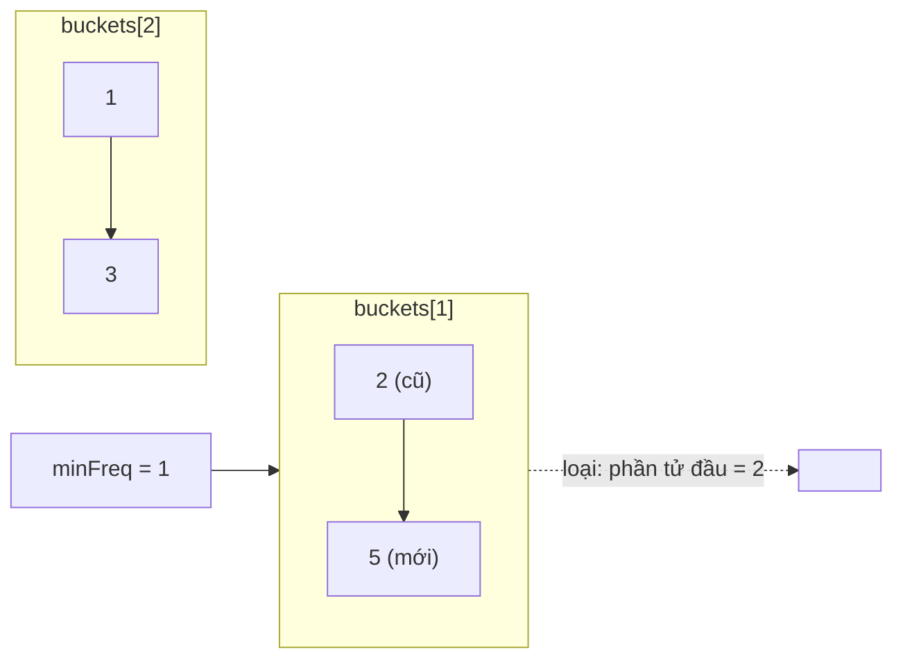

<!-- approaches: Frequency buckets of insertion-ordered sets with a min-frequency pointer · TreeMap of frequency lists -->
# 460. LFU Cache

**Hard** · Hash Table · Linked List · Design · Doubly-Linked List · [LeetCode ↗](https://leetcode.com/problems/lfu-cache/) · Code: [LFUCache.java](LFUCache.java) · Tests: [LFUCacheTest.java](LFUCacheTest.java)

## Đề bài

Thiết kế **LFU cache** với `get` và `put` trung bình `O(1)`. Khi đầy, loại khoá **dùng ít lần nhất**; nếu nhiều khoá cùng số lần thì loại khoá **lâu chưa dùng nhất** (LRU trong nhóm).

## Ý tưởng

> Cần biết nhanh "nhóm có tần suất **nhỏ nhất**" và "khoá **cũ nhất** trong nhóm đó". Ba bảng:
> - `values[key]`, `freq[key]`;
> - `buckets[f]` = các khoá có tần suất `f`, **theo thứ tự dùng gần đây** (`LinkedHashSet`: phần tử đầu là cũ nhất);
> - biến `minFreq` = tần suất nhỏ nhất hiện có.

**Mỗi lần dùng một khoá** (`get` hoặc `put` khoá cũ): chuyển nó từ `buckets[f]` sang `buckets[f+1]` (vào **cuối**). Nếu `buckets[f]` thành rỗng và `f == minFreq` thì `minFreq++`.
**Thêm khoá mới:** nếu đầy, loại phần tử đầu của `buckets[minFreq]`; khoá mới có tần suất 1 → `minFreq = 1`.

`minFreq` không bao giờ cần "tìm lại": nó chỉ tăng đúng 1 khi khoá cuối cùng của nhóm nhỏ nhất được dùng, hoặc về 1 khi thêm khoá mới.

## Cách 1 — Nhóm tần suất + `minFreq` `O(1)` ⭐

## Cách 2 — `TreeMap` tần suất → nhóm

`firstEntry()` cho nhóm nhỏ nhất, không cần theo dõi `minFreq`. Đơn giản hơn nhưng `O(log F)`.

## So với LRU (146)

| | LRU | LFU |
|---|---|---|
| Loại | lâu chưa dùng nhất | ít dùng nhất, rồi lâu chưa dùng nhất |
| Cấu trúc | HashMap + danh sách liên kết đôi | HashMap + nhóm tần suất (mỗi nhóm là một LRU) + `minFreq` |

## Bài liên quan

146 LRU Cache · 432 All O`one Data Structure · 895 Maximum Frequency Stack · 1206 Design Skiplist.
