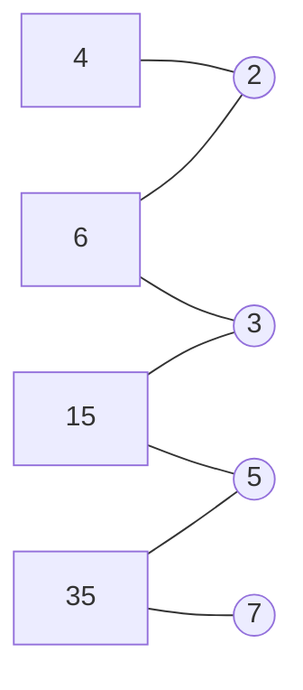

<!-- approaches: Union-find on prime factors · Union-find on all factors up to sqrt -->
# 952. Largest Component Size by Common Factor

**Hard** · Array · Hash Table · Math · Union-Find · [LeetCode ↗](https://leetcode.com/problems/largest-component-size-by-common-factor/) · Code: [LargestComponentSizeByCommonFactor.java](LargestComponentSizeByCommonFactor.java) · Tests: [LargestComponentSizeByCommonFactorTest.java](LargestComponentSizeByCommonFactorTest.java)

## Đề bài

Mỗi số khác nhau trong `nums` là một đỉnh; hai đỉnh nối nhau nếu có **ước chung > 1**. Thành phần liên thông lớn nhất có bao nhiêu đỉnh?

```
[4,6,15,35] -> 4      4–6 (2), 6–15 (3), 15–35 (5)
```

## Ý tưởng

> So từng cặp số (gcd) tốn `O(n²)` — quá chậm với `n = 2·10⁴`. Đổi góc nhìn: hai số nối nhau ⇔ **chung một thừa số nguyên tố**. Coi mỗi **số nguyên tố** cũng là một "đỉnh trung gian": hợp nhất mỗi số với các thừa số nguyên tố của nó. Hai số chung thừa số `p` tự động vào cùng một tập qua `p`.



Mọi số đều nối qua các nguyên tố → một thành phần gồm 4 số.

## Cách 1 — Union-Find trên thừa số nguyên tố `O(n√max)` ⭐

Phân tích thừa số bằng chia thử tới `√v`; phần còn lại `> 1` là một thừa số nguyên tố lớn. Mảng `parent` có kích thước `max + 1` (đỉnh là **giá trị**, gồm cả số trong `nums` và các nguyên tố). Cuối cùng chỉ đếm kích thước tập theo các số trong `nums`.

## Cách 2 — Union-Find với mọi cặp ước `(f, x/f)`

Không cần tách riêng nguyên tố: hợp nhất `x` với mọi ước của nó. Đúng vì mọi ước đều chứa các thừa số nguyên tố của `x`. Ngắn hơn, nhiều phép hợp nhất hơn.

## Câu hỏi mở rộng

`max` tới 10⁵ → có thể dùng **sàng ước nguyên tố nhỏ nhất** (smallest prime factor sieve) để phân tích mỗi số trong `O(log max)`.

## Bài liên quan

839 Similar String Groups · 1998 GCD Sort of an Array · 2709 Greatest Common Divisor Traversal · 547 Number of Provinces.
