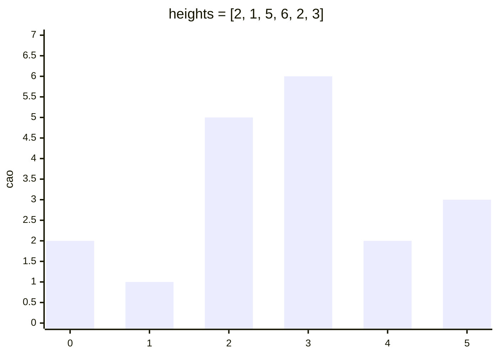

<!-- approaches: Brute force expanding from each bar · Monotonic stack · Nearest smaller on both sides -->
# 84. Largest Rectangle in Histogram

**Hard** · Array · Stack · Monotonic Stack · Range Minimum/Maximum Query · [LeetCode ↗](https://leetcode.com/problems/largest-rectangle-in-histogram/) · Code: [LargestRectangleInHistogram.java](LargestRectangleInHistogram.java) · Tests: [LargestRectangleInHistogramTest.java](LargestRectangleInHistogramTest.java)

## Đề bài

Biểu đồ cột, mỗi cột rộng 1. Tìm diện tích **hình chữ nhật lớn nhất** nằm trong biểu đồ.

```
[2,1,5,6,2,3] -> 10    (cột cao 5 và 6, cao 5 × rộng 2)
```



## Ý tưởng

> Mỗi hình chữ nhật tối ưu có **một cột thấp nhất** quyết định chiều cao. Với mỗi cột `i` làm cột thấp nhất, hình chữ nhật kéo rộng tới **cột thấp hơn gần nhất** ở bên trái và bên phải:
> `diện tích = heights[i] × (right[i] − left[i] − 1)`.
> Tìm "cột thấp hơn gần nhất" cho mọi cột trong `O(n)` bằng **stack đơn điệu**.

## Cách 1 — Nở từ mỗi cột `O(n²)`

## Cách 2 — Stack đơn điệu một lượt `O(n)` ⭐

Stack giữ chỉ số các cột **cao dần**. Khi gặp cột thấp hơn `h`:
- cột ở đỉnh stack không thể kéo sang phải nữa → **biên phải** = vị trí hiện tại;
- **biên trái** = phần tử ngay dưới nó trong stack (cột thấp hơn gần nhất bên trái).

| i | h | pop (cao × rộng) | stack sau |
|---|---|---|---|
| 0 | 2 | | 0 |
| 1 | 1 | 2 × 1 = 2 | 1 |
| 2 | 5 | | 1 2 |
| 3 | 6 | | 1 2 3 |
| 4 | 2 | 6 × 1 = 6, 5 × 2 = **10** | 1 4 |
| 5 | 3 | | 1 4 5 |
| 6 (lính canh 0) | 0 | 3 × 1, 2 × 4 = 8, 1 × 6 = 6 | |

Cột lính canh cao 0 ở cuối buộc stack xả hết.

## Cách 3 — Tính trước cột thấp hơn gần nhất hai bên

Hai lượt stack riêng cho `left[]` và `right[]`, rồi một công thức cho mỗi cột. Dễ giải thích hơn cách 2.

## Bài liên quan

85 Maximal Rectangle (chạy bài này trên mỗi hàng) · 42 Trapping Rain Water · 739 Daily Temperatures · 907 Sum of Subarray Minimums.
