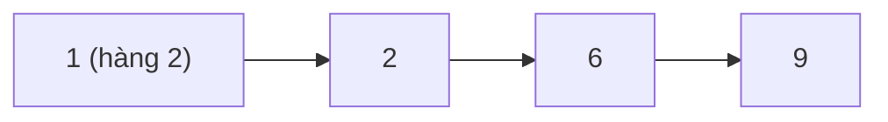

<!-- approaches: DFS with memoization · Topological sort by peeling (BFS) -->
# 329. Longest Increasing Path in a Matrix

**Hard** · Array · Dynamic Programming · Depth-First Search · Breadth-First Search · [LeetCode ↗](https://leetcode.com/problems/longest-increasing-path-in-a-matrix/) · Code: [LongestIncreasingPathInAMatrix.java](LongestIncreasingPathInAMatrix.java) · Tests: [LongestIncreasingPathInAMatrixTest.java](LongestIncreasingPathInAMatrixTest.java)

## Đề bài

Tìm độ dài **đường đi tăng ngặt** dài nhất trong ma trận (đi 4 hướng).

```
9 9 4
6 6 8      -> 4   (1 → 2 → 6 → 9)
2 1 1
```

## Ý tưởng

> `longest(ô)` = `1 + max(longest(láng giềng lớn hơn))`. Vì đường đi **tăng ngặt**, không bao giờ quay lại ô cũ → đồ thị "đi tới ô lớn hơn" là một **DAG**, không có chu trình → chỉ cần **ghi nhớ** kết quả mỗi ô, không cần mảng "đang thăm".



Bảng `longest` cho ví dụ:

| | | |
|---|---|---|
| 1 | 1 | 2 |
| 2 | 2 | 1 |
| 3 | **4** | 2 |

## Cách 1 — DFS + ghi nhớ `O(m·n)` ⭐

Mỗi ô được tính đúng một lần, mỗi lần xét 4 láng giềng.

## Cách 2 — Sắp xếp tô-pô bằng "bóc lớp"

Bóc dần các ô **không có láng giềng lớn hơn** (đỉnh cục bộ) — đó là lớp 1; xoá chúng đi thì lộ ra lớp 2… Số lớp bóc được chính là độ dài đường dài nhất (giống thuật toán Kahn, bài 210). Không đệ quy — an toàn với ma trận lớn.

## Bài liên quan

300 Longest Increasing Subsequence · 2328 Number of Increasing Paths in a Grid · 1857 Largest Color Value in a Directed Graph · 210 Course Schedule II.
