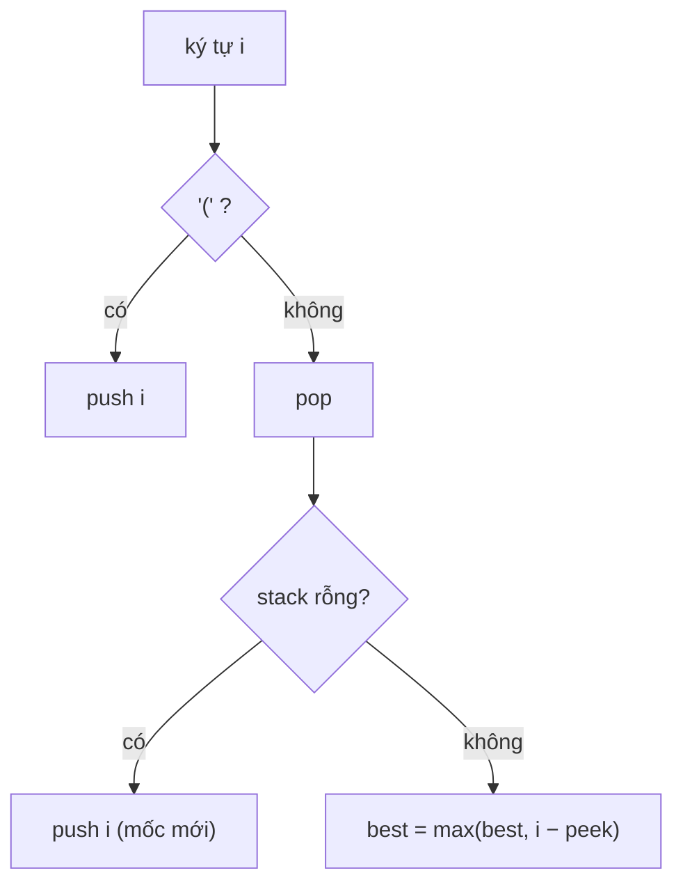

<!-- approaches: Stack of indexes · DP over end positions · Two counters scanning both ways -->
# 32. Longest Valid Parentheses

**Hard** · String · Dynamic Programming · Stack · Bracket Sequences · [LeetCode ↗](https://leetcode.com/problems/longest-valid-parentheses/) · Code: [LongestValidParentheses.java](LongestValidParentheses.java) · Tests: [LongestValidParenthesesTest.java](LongestValidParenthesesTest.java)

## Đề bài

Độ dài **chuỗi con ngoặc hợp lệ** dài nhất.

```
")()())" -> 4  ("()()")        "(()" -> 2
```

## Ý tưởng — Stack chỉ số

> Stack lưu **chỉ số** các `(` chưa đóng, và ở **đáy** là chỉ số ngay **trước** đoạn hợp lệ hiện tại (khởi tạo `−1`).
> - Gặp `(`: đẩy chỉ số.
> - Gặp `)`: pop. Stack **rỗng** → `)` này không có cặp, trở thành **mốc mới**. Không rỗng → đoạn hợp lệ kết thúc tại `i` dài `i − đỉnh stack`.

`")()())"`:

| i | ký tự | stack sau | độ dài |
|---|---|---|---|
| 0 | ) | pop −1, rỗng → push 0 | |
| 1 | ( | 0 1 | |
| 2 | ) | 0 | 2 − 0 = 2 |
| 3 | ( | 0 3 | |
| 4 | ) | 0 | 4 − 0 = **4** |
| 5 | ) | pop 0, rỗng → push 5 | |



## Cách 1 — Stack chỉ số `O(n)` ⭐

## Cách 2 — DP theo vị trí kết thúc

`dp[i]` = đoạn hợp lệ dài nhất **kết thúc tại** `i`. Với `s[i] = ')'`:
- `s[i−1] = '('` → `dp[i] = dp[i−2] + 2` (dán vào đoạn trước đó);
- `s[i−1] = ')'` → `(` khớp với `s[i]` nằm ở `i − dp[i−1] − 1`; nếu đúng là `(` thì `dp[i] = dp[i−1] + 2 + dp[trước nó]`.

## Cách 3 — Hai bộ đếm, quét hai chiều `O(1)` bộ nhớ

Quét trái → phải đếm `(` và `)`: bằng nhau → cập nhật; `)` nhiều hơn → đặt lại 0. Lượt này bỏ sót trường hợp `(` thừa như `"(()"` → quét thêm phải → trái với vai trò đảo lại.

## Bài liên quan

20 Valid Parentheses · 22 Generate Parentheses · 301 Remove Invalid Parentheses · 1249 Minimum Remove to Make Valid Parentheses.
