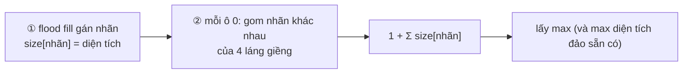

<!-- approaches: Try every 0 with a fresh flood fill · Label islands once, then join neighbours -->
# 827. Making A Large Island

**Hard** · Array · Depth-First Search · Breadth-First Search · Union-Find · [LeetCode ↗](https://leetcode.com/problems/making-a-large-island/) · Code: [MakingALargeIsland.java](MakingALargeIsland.java) · Tests: [MakingALargeIslandTest.java](MakingALargeIslandTest.java)

## Đề bài

Lưới nhị phân `n × n`. Được đổi **tối đa một** ô `0` thành `1`. Đảo lớn nhất sau đó có diện tích bao nhiêu?

```
1 0
0 1      -> 3   (đổi một ô 0 nối hai đảo đơn)
```

## Ý tưởng

> Đổi ô `0` tại `(i, j)` → đảo mới = **1 + tổng diện tích các đảo khác nhau** chạm vào ô đó.
> Tính trước: **gán nhãn** mỗi đảo (2, 3, 4…) bằng flood fill và lưu diện tích theo nhãn. Sau đó mỗi ô 0 chỉ cần nhìn 4 láng giềng.

```
 nhãn:  2 2 0 3          ô 0 ở giữa chạm đảo 2 (diện tích 3) và đảo 3 (diện tích 2)
        2 0 0 3          → 1 + 3 + 2 = 6
        0 0 4 0
```



## Cách 1 — Thử từng ô 0 + flood fill `O(n⁴)`

## Cách 2 — Gán nhãn một lần `O(n²)` ⭐

**Bẫy:** hai láng giềng có thể thuộc **cùng một đảo** → dùng `Set` để không cộng trùng.
**Bẫy:** lưới toàn số 1 (không có ô 0 để đổi) → đáp án là `n²`; lưới toàn 0 → 1.

## Bài liên quan

695 Max Area of Island · 200 Number of Islands · 1568 Minimum Number of Days to Disconnect Island · 803 Bricks Falling When Hit.
