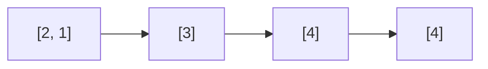

<!-- approaches: Prefix max vs suffix min · Monotonic stack of chunk maxima · Compare with sorted copy -->
# 768. Max Chunks To Make Sorted II

**Hard** · Array · Stack · Greedy · Sorting · [LeetCode ↗](https://leetcode.com/problems/max-chunks-to-make-sorted-ii/) · Code: [MaxChunksToMakeSortedII.java](MaxChunksToMakeSortedII.java) · Tests: [MaxChunksToMakeSortedIITest.java](MaxChunksToMakeSortedIITest.java)

## Đề bài

Chia mảng thành **nhiều khúc nhất** sao cho sắp xếp từng khúc rồi nối lại thì được mảng đã sắp xếp. Giá trị có thể trùng.

```
[2,1,3,4,4] -> 4    [2,1] [3] [4] [4]
[5,4,3,2,1] -> 1
```

## Ý tưởng

> Được phép cắt sau vị trí `i` ⇔ **mọi** phần tử bên trái `≤` **mọi** phần tử bên phải ⇔ `max(trái) ≤ min(phải)`. Đếm số vị trí cắt hợp lệ.

| i | 0 | 1 | 2 | 3 | 4 |
|---|---|---|---|---|---|
| arr | 2 | 1 | 3 | 4 | 4 |
| max trái (tới i) | 2 | 2 | 3 | 4 | 4 |
| min phải (từ i+1) | 1 | 3 | 4 | 4 | ∞ |
| cắt được? | ✗ | ✓ | ✓ | ✓ | ✓ |



## Cách 1 — Max tiền tố vs min hậu tố `O(n)` ⭐

## Cách 2 — Stack các max khúc `O(n)`

Stack chứa **max của từng khúc**, tăng dần. Số mới `x` nhỏ hơn max của khúc nào thì phải **gộp** vào khúc đó (nếu không, sau khi sắp xếp `x` sẽ đứng sai chỗ). Gộp liên tục, khúc mới giữ max lớn nhất. Cuối cùng số khúc = kích thước stack. Đây là cách xử lý được cả dạng "luồng".

## Cách 3 — So tổng tiền tố với mảng đã sắp xếp

Cắt được sau `i` khi `i + 1` phần tử đầu là **cùng một tập** (đa tập) với `i + 1` phần tử đầu của mảng đã sắp xếp. Mẹo dùng **tổng**: với mảng đã sắp xếp, tổng tiền tố là nhỏ nhất có thể nên hai tổng bằng nhau ⇔ hai đa tập trùng nhau.

## Bài liên quan

769 Max Chunks To Make Sorted (hoán vị 0..n−1) · 915 Partition Array into Disjoint Intervals · 42 Trapping Rain Water (max trái / min phải).
