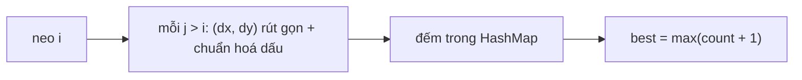

<!-- approaches: Slopes from each anchor as reduced fractions -->
# 149. Max Points on a Line

**Hard** · Array · Hash Table · Math · Geometry · [LeetCode ↗](https://leetcode.com/problems/max-points-on-a-line/) · Code: [MaxPointsOnALine.java](MaxPointsOnALine.java) · Tests: [MaxPointsOnALineTest.java](MaxPointsOnALineTest.java)

## Đề bài

Cho các điểm **phân biệt** trên mặt phẳng, tìm số điểm nhiều nhất cùng nằm trên một đường thẳng.

## Ý tưởng

> Cố định một điểm **neo** `A`. Mọi điểm `B` khác xác định một **hướng** `(dx, dy)`. Các điểm cùng hướng với `A` thì nằm trên cùng một đường thẳng qua `A` → đếm bằng HashMap.
> Đáp án = max qua mọi điểm neo của (số điểm cùng hướng nhiều nhất + 1).

**Biểu diễn hệ số góc không dùng số thực** — `dy/dx` dạng `double` bị sai số (test có hai điểm gần như thẳng hàng với tọa độ lớn):
- chia `dx, dy` cho `gcd(|dx|, |dy|)`;
- chuẩn hoá dấu: `dx > 0`, hoặc `dx = 0` thì `dy > 0`.

```
A = (1,1):  B = (3,2) → (2,1)    B = (5,3) → (4,2) → (2,1)  cùng hướng ✓
```



## Lời giải `O(n² log C)` ⭐

Đường thẳng đứng (`dx = 0`) và nằm ngang (`dy = 0`) được xử lý tự nhiên: `gcd(0, a) = a` → `(0, 1)` và `(1, 0)`.

## Bài liên quan

1232 Check If It Is a Straight Line · 2152 Minimum Number of Lines to Cover Points · 939 Minimum Area Rectangle.
