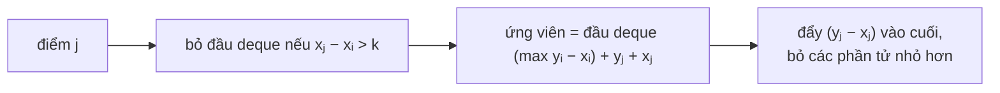

<!-- approaches: Monotonic deque over xi - ... · Max-heap with lazy expiry -->
# 1499. Max Value of Equation

**Hard** · Array · Queue · Sliding Window · Heap (Priority Queue) · [LeetCode ↗](https://leetcode.com/problems/max-value-of-equation/) · Code: [MaxValueOfEquation.java](MaxValueOfEquation.java) · Tests: [MaxValueOfEquationTest.java](MaxValueOfEquationTest.java)

## Đề bài

Các điểm đã sắp xếp theo `x`. Tìm giá trị lớn nhất của `yᵢ + yⱼ + |xᵢ − xⱼ|` với `i < j` và `|xᵢ − xⱼ| ≤ k`.

```
[[1,3],[2,0],[5,10],[6,-10]], k = 1 -> 4    (điểm 0 và 1: 3 + 0 + 1)
```

## Ý tưởng

> Vì `xⱼ > xᵢ`, biểu thức **tách được** thành hai phần độc lập:
> `yᵢ + yⱼ + xⱼ − xᵢ = (yᵢ − xᵢ) + (yⱼ + xⱼ)`.
> Với mỗi `j`, phần `(yⱼ + xⱼ)` cố định → chỉ cần **max của `yᵢ − xᵢ`** trong các điểm trước đó còn nằm trong **cửa sổ** `xⱼ − xᵢ ≤ k`. Đó chính là bài **cửa sổ trượt lấy max** (239) → deque đơn điệu.



| j | (x, y) | deque `y−x` | ứng viên |
|---|---|---|---|
| 0 | (1, 3) | 2 | |
| 1 | (2, 0) | 2, −2 | 2 + 0 + 2 = **4** |
| 2 | (5, 10) | (hết hạn) → 5 | |
| 3 | (6, −10) | 5, −16 | 5 − 10 + 6 = 1 |

## Cách 1 — Deque đơn điệu `O(n)` ⭐

## Cách 2 — Max-heap + bỏ trễ `O(n log n)`

Đỉnh heap quá xa (`xⱼ − xᵢ > k`) thì bỏ — vì `x` tăng dần, nó không bao giờ hợp lệ trở lại.

## Bài học

Mẹo "**tách biểu thức theo `i` và `j`**" biến bài hai biến thành bài một biến + cấu trúc dữ liệu — dùng lại ở 1014 Best Sightseeing Pair, 121 Best Time to Buy and Sell Stock.

## Bài liên quan

239 Sliding Window Maximum · 1014 Best Sightseeing Pair · 862 Shortest Subarray with Sum at Least K · 1696 Jump Game VI.
