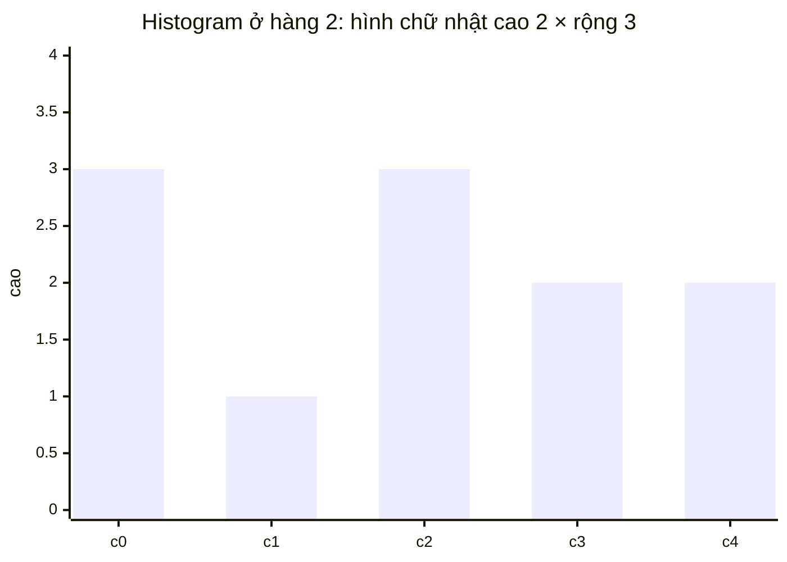

<!-- approaches: Histogram per row + monotonic stack · DP with left/right/height arrays -->
# 85. Maximal Rectangle

**Hard** · Array · Dynamic Programming · Stack · Matrix · [LeetCode ↗](https://leetcode.com/problems/maximal-rectangle/) · Code: [MaximalRectangle.java](MaximalRectangle.java) · Tests: [MaximalRectangleTest.java](MaximalRectangleTest.java)

## Đề bài

Ma trận `'0'`/`'1'`. Tìm diện tích **hình chữ nhật lớn nhất** chỉ chứa `'1'`.

```
1 0 1 0 0
1 0 1 1 1       -> 6   (hàng 1–2, cột 2–4)
1 1 1 1 1
1 0 0 1 0
```

## Ý tưởng

> Đứng ở mỗi hàng nhìn **lên trên**: chiều cao cột `j` = số `'1'` liên tiếp tính từ hàng hiện tại trở lên. Mỗi hàng trở thành một **biểu đồ cột** (histogram), và hình chữ nhật lớn nhất có đáy ở hàng đó là bài **84 Largest Rectangle in Histogram**.

| hàng | chiều cao các cột | HCN lớn nhất của histogram |
|---|---|---|
| 0 | 1 0 1 0 0 | 1 |
| 1 | 2 0 2 1 1 | 3 |
| 2 | 3 1 3 2 2 | **6** (cao 2 × rộng 3) |
| 3 | 4 0 0 3 0 | 4 |



## Cách 1 — Histogram mỗi hàng + stack đơn điệu `O(m·n)` ⭐

Bài 84: stack giữ chỉ số các cột có chiều cao **tăng dần**. Khi gặp cột thấp hơn, lấy cột cao ra — nó không thể kéo dài sang phải nữa; chiều rộng của nó kéo từ phần tử dưới nó trong stack (bên trái) tới vị trí hiện tại (bên phải). Thêm một cột ảo chiều cao 0 ở cuối để "xả" hết stack.

## Cách 2 — DP ba mảng `left / right / height`

Với mỗi ô, `height` = số `'1'` liên tiếp phía trên; `left`, `right` = cột đó có thể kéo rộng tới đâu ở chiều cao ấy (bị giới hạn bởi cả các hàng phía trên). Diện tích = `height × (right − left)`.

## Bài liên quan

84 Largest Rectangle in Histogram · 221 Maximal Square · 1504 Count Submatrices With All Ones · 42 Trapping Rain Water.
