<!-- approaches: Sort by end + binary search DP · Sort by start + memo with binary search -->
# 1235. Maximum Profit in Job Scheduling

**Hard** · Array · Binary Search · Dynamic Programming · Sorting · [LeetCode ↗](https://leetcode.com/problems/maximum-profit-in-job-scheduling/) · Code: [MaximumProfitInJobScheduling.java](MaximumProfitInJobScheduling.java) · Tests: [MaximumProfitInJobSchedulingTest.java](MaximumProfitInJobSchedulingTest.java)

## Đề bài

Công việc `i` chạy từ `startTime[i]` tới `endTime[i]`, lợi nhuận `profit[i]`. Chọn các việc **không chồng nhau** (được bắt đầu đúng lúc việc khác kết thúc) để tổng lợi nhuận lớn nhất.

```
start = [1,2,3,3], end = [3,4,5,6], profit = [50,10,40,70] -> 120   (việc 1–3 và 3–6)
```

## Ý tưởng

> Đây là **lập lịch khoảng có trọng số** — tham lam như bài 435 không còn đúng, phải dùng **DP**.
> Sắp xếp theo **thời điểm kết thúc**. Với việc `i`, hai lựa chọn:
> - **bỏ** → `dp[i−1]`;
> - **làm** → `profit[i] + dp[j]`, với `j` = số việc **kết thúc trước khi việc `i` bắt đầu** (tìm bằng **nhị phân** vì đã sắp theo end).

```mermaid
gantt
    dateFormat X
    axisFormat %s
    section chọn
    việc 1 (50) :done, 1, 3
    việc 4 (70) :done, 3, 6
    section bỏ
    việc 2 (10) :crit, 2, 4
    việc 3 (40) :crit, 3, 5
```



| i (theo end) | việc | bỏ | làm | dp |
|---|---|---|---|---|
| 1 | [1,3] 50 | 0 | 50 + dp[0] | 50 |
| 2 | [2,4] 10 | 50 | 10 + dp[0] | 50 |
| 3 | [3,5] 40 | 50 | 40 + dp[1] = 90 | 90 |
| 4 | [3,6] 70 | 90 | 70 + dp[1] = 120 | **120** |

## Cách 1 — Sắp theo end + DP + nhị phân `O(n log n)` ⭐

## Cách 2 — Sắp theo start, DP từ cuối

`best(i)` = lợi nhuận tốt nhất từ việc thứ `i` (theo start) trở đi = `max(best(i+1), profit + best(việc đầu tiên bắt đầu ≥ end của i))`.

## Bài liên quan

435 Non-overlapping Intervals (không trọng số → tham lam) · 1751 Maximum Number of Events That Can Be Attended II · 2008 Maximum Earnings From Taxi · 1353 Maximum Number of Events That Can Be Attended.
