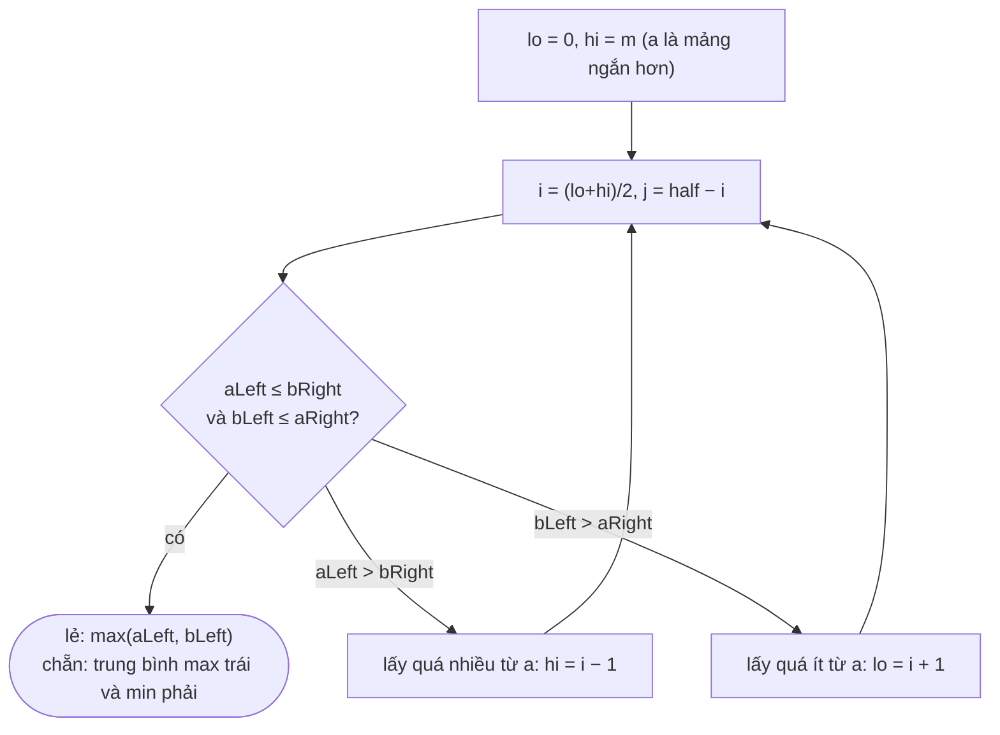

<!-- approaches: Merge to the middle · k-th smallest · Binary search on partition -->
# 4. Median of Two Sorted Arrays

**Hard** · Array · Binary Search · Divide and Conquer · [LeetCode ↗](https://leetcode.com/problems/median-of-two-sorted-arrays/) · Code: [MedianOfTwoSortedArrays.java](MedianOfTwoSortedArrays.java) · Tests: [MedianOfTwoSortedArraysTest.java](MedianOfTwoSortedArraysTest.java)

## Đề bài

Hai mảng đã sắp xếp, tìm **trung vị** của hợp hai mảng trong `O(log(m+n))`.

```
[1,3] + [2]   -> 2.0       [1,2] + [3,4] -> 2.5
```

## Ý tưởng

> Trung vị **chia đôi** tập hợp: nửa trái gồm `⌈(m+n)/2⌉` phần tử, mọi phần tử trái ≤ mọi phần tử phải.
> Nếu lấy `i` phần tử đầu của `a` vào nửa trái thì **bắt buộc** lấy `j = half − i` phần tử đầu của `b`.
> Chỉ còn một ẩn `i` → **tìm kiếm nhị phân** trên `i`.

```
          left half              |   right half
 a:  a[0] … a[i−1]               |   a[i] … a[m−1]
 b:  b[0] … b[j−1]               |   b[j] … b[n−1]

 hợp lệ khi:  a[i−1] ≤ b[j]   và   b[j−1] ≤ a[i]
```

## Cách 1 — Trộn tới giữa `O(m+n)`

Trộn như merge sort nhưng chỉ đi tới vị trí giữa, giữ hai giá trị cuối. Không đạt yêu cầu log, nhưng là câu trả lời đầu tiên tốt.

## Cách 2 — Phần tử nhỏ thứ k `O(log(m+n))`

So `a[k/2 − 1]` và `b[k/2 − 1]`: bên nhỏ hơn có `k/2` phần tử chắc chắn **không** thể là phần tử thứ `k` → loại bỏ, tìm phần tử thứ `k − k/2` trên phần còn lại.

## Cách 3 — Nhị phân trên vị trí cắt `O(log min(m,n))` ⭐



`a = [1, 3]`, `b = [2]` → đổi chỗ để `a = [2]` (ngắn hơn), `b = [1, 3]`, `half = 2`:

| lo | hi | i | j | aLeft | aRight | bLeft | bRight | kết luận |
|---|---|---|---|---|---|---|---|---|
| 0 | 1 | 0 | 2 | −∞ | 2 | 3 | +∞ | bLeft > aRight → lo = 1 |
| 1 | 1 | 1 | 1 | 2 | +∞ | 1 | 3 | hợp lệ → lẻ → max(2, 1) = **2** |

## Bẫy & lưu ý

- Luôn nhị phân trên mảng **ngắn hơn** để `j` không bị âm.
- Biên `i = 0`, `i = m`, `j = 0`, `j = n` thay bằng `±∞`.
- `half = (m + n + 1) / 2` cho nửa trái nhiều hơn một khi tổng lẻ → trung vị là `max` bên trái.

## Bài liên quan

215 Kth Largest Element in an Array · 295 Find Median from Data Stream · 378 Kth Smallest Element in a Sorted Matrix.
