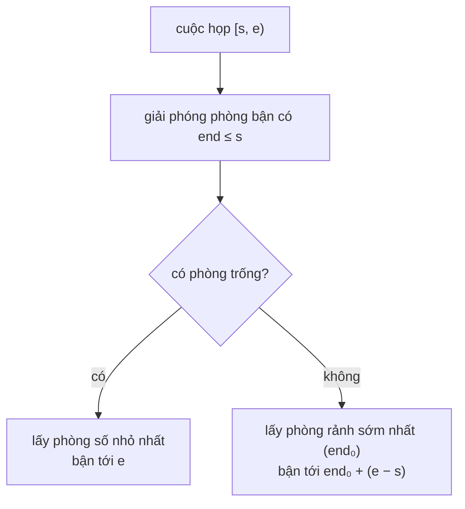

<!-- approaches: Two heaps (free rooms, busy rooms) · Linear scan over rooms -->
# 2402. Meeting Rooms III

**Hard** · Array · Hash Table · Sorting · Heap (Priority Queue) · [LeetCode ↗](https://leetcode.com/problems/meeting-rooms-iii/) · Code: [MeetingRoomsIII.java](MeetingRoomsIII.java) · Tests: [MeetingRoomsIIITest.java](MeetingRoomsIIITest.java)

## Đề bài

`n` phòng họp số `0…n−1`; các cuộc họp `[start, end)` có `start` khác nhau. Mỗi cuộc họp vào **phòng trống số nhỏ nhất**; nếu không có phòng trống thì **hoãn** tới khi phòng sớm rảnh nhất trống (giữ nguyên thời lượng). Phòng nào được dùng nhiều nhất (bằng nhau lấy số nhỏ nhất)?

```
n = 2, [[0,10],[1,5],[2,7],[3,4]] -> 0
```

## Ý tưởng

> Mô phỏng theo thứ tự `start`, cần trả lời nhanh hai câu hỏi:
> 1. "Phòng **trống** có số **nhỏ nhất** là phòng nào?" → **min-heap số phòng**.
> 2. "Phòng **bận** nào rảnh **sớm nhất**?" → **min-heap theo (giờ kết thúc, số phòng)**.
> Trước mỗi cuộc họp, chuyển mọi phòng đã kết thúc (`end ≤ start`) từ heap bận sang heap trống.



`n = 2`:

| họp | trống | bận (end, phòng) | vào phòng |
|---|---|---|---|
| [0,10] | 0 1 | | 0 → (10,0) |
| [1,5] | 1 | (10,0) | 1 → (5,1) |
| [2,7] | – | (5,1) (10,0) | hoãn vào 1: 5 + 5 = (10,1) |
| [3,4] | – | (10,0) (10,1) | hoãn vào 0: (11,0) |

Phòng 0 và 1 đều 2 lần → **0**.

## Cách 1 — Hai heap `O(m log n)` ⭐

**Bẫy:** khi hai phòng rảnh cùng lúc, phải chọn **số nhỏ hơn** → so sánh heap bận theo `(end, phòng)`. Giờ kết thúc sau khi hoãn có thể vượt `int` → dùng `long`.

## Cách 2 — Quét mảng thời điểm rảnh `O(m·n)`

Dễ viết, dùng làm chuẩn để test.

## Bài liên quan

253 Meeting Rooms II · 1882 Process Tasks Using Servers · 1606 Find Servers That Handled Most Number of Requests · 621 Task Scheduler.
