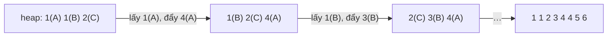

<!-- approaches: Min-heap of list heads · Divide and conquer pairwise merges · Collect and sort -->
# 23. Merge k Sorted Lists

**Hard** · Linked List · Divide and Conquer · Heap (Priority Queue) · Merge Sort · [LeetCode ↗](https://leetcode.com/problems/merge-k-sorted-lists/) · Code: [MergeKSortedLists.java](MergeKSortedLists.java) · Tests: [MergeKSortedListsTest.java](MergeKSortedListsTest.java)

## Đề bài

Trộn `k` danh sách liên kết **đã sắp xếp** thành một danh sách sắp xếp.

```
[1,4,5], [1,3,4], [2,6]  ->  1 → 1 → 2 → 3 → 4 → 4 → 5 → 6
```

## Ý tưởng

> Như trộn hai danh sách (bài 21), nhưng mỗi bước phải chọn phần tử nhỏ nhất trong **k** đầu danh sách. So tuyến tính `k` đầu mỗi bước tốn `O(N·k)`. Dùng **min-heap** chứa `k` đầu danh sách → mỗi bước `O(log k)`.



## Cách 1 — Gom giá trị, sắp xếp `O(N log N)`

## Cách 2 — Min-heap `O(N log k)` ⭐

Heap chỉ giữ **tối đa k** node (mỗi danh sách một đại diện), nên mỗi thao tác là `log k` chứ không phải `log N`.

## Cách 3 — Chia để trị (trộn từng cặp)

Mỗi vòng trộn danh sách theo cặp: `k` → `k/2` → … → 1. Có `log k` vòng, mỗi vòng duyệt tổng `N` node → `O(N log k)`, không cần heap. Giống hệt merge sort.

| vòng | số danh sách |
|---|---|
| 0 | 8 |
| 1 | 4 |
| 2 | 2 |
| 3 | 1 |

## Bẫy & lưu ý

- Trộn **tuần tự** (danh sách 1 với 2, kết quả với 3, …) tốn `O(N·k)` — danh sách đầu bị duyệt lại `k` lần.
- Bỏ qua các danh sách rỗng (`null`) khi đưa vào heap.

## Bài liên quan

21 Merge Two Sorted Lists · 148 Sort List · 632 Smallest Range Covering Elements from K Lists · 378 Kth Smallest Element in a Sorted Matrix.
