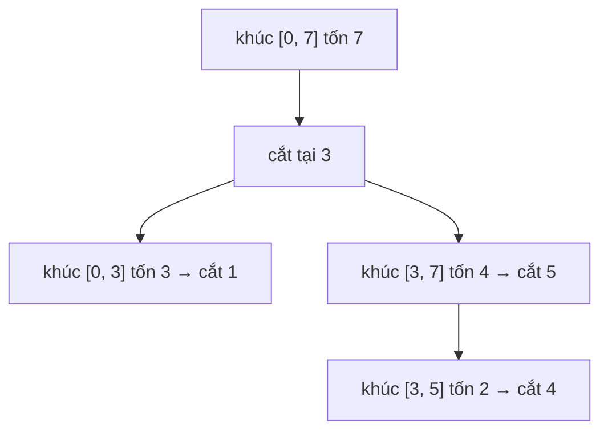

<!-- approaches: Interval DP over sorted cut positions · Memoized recursion -->
# 1547. Minimum Cost to Cut a Stick

**Hard** · Array · Dynamic Programming · Sorting · [LeetCode ↗](https://leetcode.com/problems/minimum-cost-to-cut-a-stick/) · Code: [MinimumCostToCutAStick.java](MinimumCostToCutAStick.java) · Tests: [MinimumCostToCutAStickTest.java](MinimumCostToCutAStickTest.java)

## Đề bài

Cây gậy dài `n` cần cắt tại các vị trí `cuts` (theo thứ tự tuỳ chọn). Mỗi lần cắt tốn chi phí bằng **độ dài khúc đang cắt**. Tổng chi phí nhỏ nhất?

```
n = 7, cuts = [1,3,4,5] -> 16
  cắt 3 (khúc 0–7, tốn 7) → cắt 1 (khúc 0–3, tốn 3) → cắt 5 (khúc 3–7, tốn 4) → cắt 4 (khúc 3–5, tốn 2)
```

## Ý tưởng

> Thêm hai mốc `0` và `n`, sắp xếp: `p = [0, 1, 3, 4, 5, 7]`. Một khúc giữa hai mốc `p[i]` và `p[j]` cần cắt tại mọi mốc nằm giữa.
> Chọn vết cắt **đầu tiên** `k` trong khúc này: tốn `p[j] − p[i]`, sau đó hai khúc `(i, k)` và `(k, j)` là hai bài toán **độc lập**.

`dp[i][j] = (p[j] − p[i]) + min over k of (dp[i][k] + dp[k][j])`



## Cách 1 — DP khoảng trên các mốc đã sắp xếp `O(m³)` ⭐

Làm việc trên **chỉ số mốc** (tối đa ~100 mốc), không phải trên độ dài gậy (tới 10⁶) — đó là chìa khoá để đủ nhanh.

## Cách 2 — Đệ quy có nhớ

## So với 312 Burst Balloons

Cùng khuôn DP khoảng. Ở 312 chọn bóng bắn **cuối cùng**; ở đây chọn vết cắt **đầu tiên** — vì chi phí phụ thuộc vào khúc **trước khi** cắt.

## Bài liên quan

312 Burst Balloons · 1039 Minimum Score Triangulation of Polygon · 1000 Minimum Cost to Merge Stones · 1130 Minimum Cost Tree From Leaf Values.
