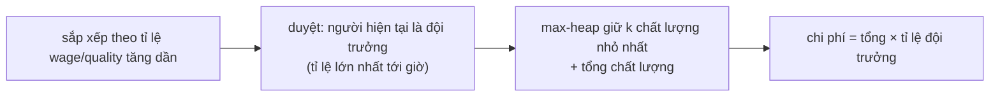

<!-- approaches: Try every captain ratio · Sort by ratio + max-heap of qualities -->
# 857. Minimum Cost to Hire K Workers

**Hard** · Array · Greedy · Sorting · Heap (Priority Queue) · [LeetCode ↗](https://leetcode.com/problems/minimum-cost-to-hire-k-workers/) · Code: [MinimumCostToHireKWorkers.java](MinimumCostToHireKWorkers.java) · Tests: [MinimumCostToHireKWorkersTest.java](MinimumCostToHireKWorkersTest.java)

## Đề bài

Thuê đúng `k` công nhân. Mỗi người được trả **ít nhất** lương tối thiểu `wage[i]`, và trong nhóm, tiền lương phải **tỉ lệ với chất lượng** `quality[i]`. Chi phí nhỏ nhất?

```
quality = [10,20,5], wage = [70,50,30], k = 2 -> 105   (thuê 0 và 2: trả 70 và 35)
```

## Ý tưởng

> Trong một nhóm, mọi người được trả cùng một **đơn giá** `R` cho mỗi đơn vị chất lượng. Để ai cũng đạt lương tối thiểu: `R ≥ wage[i] / quality[i]` với mọi `i` → `R` = **tỉ lệ lớn nhất** trong nhóm (gọi là "đội trưởng").
> Chi phí nhóm = `R × tổng chất lượng`. Với đội trưởng cố định, chọn `k − 1` người có tỉ lệ `≤ R` và **chất lượng nhỏ nhất**.



Ví dụ 1 (tỉ lệ: 7, 2.5, 6):

| xét (theo tỉ lệ) | tỉ lệ | heap chất lượng | tổng | chi phí |
|---|---|---|---|---|
| công nhân 1 | 2.5 | 20 | 20 | (chưa đủ k) |
| công nhân 2 | 6 | 20, 5 | 25 | 150 |
| công nhân 0 | 7 | bỏ 20 → 10, 5 | 15 | **105** |

## Cách 1 — Thử từng đội trưởng `O(n² log n)`

## Cách 2 — Sắp xếp theo tỉ lệ + max-heap `O(n log n)` ⭐

Khi duyệt theo tỉ lệ tăng dần, người hiện tại có tỉ lệ lớn nhất trong số đã xét → luôn là đội trưởng của nhóm chọn từ những người đó. Heap bỏ người có **chất lượng lớn nhất** để tổng nhỏ nhất.

## Bài liên quan

1383 Maximum Performance of a Team (cùng mẫu "sắp theo một tiêu chí, heap theo tiêu chí kia") · 502 IPO · 2542 Maximum Subsequence Score.
