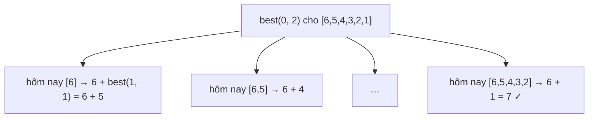

<!-- approaches: Memoized recursion over (job, days left) · Bottom-up DP · DP with a monotonic stack -->
# 1335. Minimum Difficulty of a Job Schedule

**Hard** · Array · Dynamic Programming · [LeetCode ↗](https://leetcode.com/problems/minimum-difficulty-of-a-job-schedule/) · Code: [MinimumDifficultyOfAJobSchedule.java](MinimumDifficultyOfAJobSchedule.java) · Tests: [MinimumDifficultyOfAJobScheduleTest.java](MinimumDifficultyOfAJobScheduleTest.java)

## Đề bài

Làm các việc **theo đúng thứ tự** trong `d` ngày, mỗi ngày ít nhất một việc. Độ khó một ngày = việc **khó nhất** trong ngày đó; độ khó lịch = tổng các ngày. Tìm độ khó nhỏ nhất (ít việc hơn số ngày → `−1`).

```
[6,5,4,3,2,1], d = 2 -> 7    ngày 1: 6 5 4 3 2 (max 6), ngày 2: 1
```

## Ý tưởng

> Đây là bài **chia dãy thành `d` đoạn liên tiếp** tối ưu tổng "max của đoạn". Quyết định ở mỗi bước: **hôm nay làm tới việc nào**.
> `best(i, days)` = độ khó nhỏ nhất để làm các việc từ `i` trong `days` ngày = `min over end of (max(jobs[i..end]) + best(end + 1, days − 1))`.



Ngày cuối cùng phải làm **tất cả** việc còn lại → `best(i, 1) = max(jobs[i..])`. Để mỗi ngày còn lại có ít nhất một việc, `end ≤ n − days`.

## Cách 1 — Đệ quy có nhớ `O(n²·d)` ⭐

## Cách 2 — Bảng DP từ dưới lên `O(n²·d)`

`dp[day][i]` = tốt nhất cho `i` việc đầu trong `day` ngày.

## Cách 3 — Stack đơn điệu `O(n·d)`

Với mỗi hàng `day`, khi xét việc `i` làm việc cuối của ngày hôm nay: các việc **nhỏ hơn** `jobs[i]` đứng ngay trước nó trong cùng ngày không ảnh hưởng tới "max của hôm nay" — gộp chúng lại, giữ `dp` ngày trước tốt nhất. Kỹ thuật tối ưu DP bằng stack đơn điệu (như 1130); không bắt buộc khi phỏng vấn nhưng đáng biết.

## Bài liên quan

410 Split Array Largest Sum · 1043 Partition Array for Maximum Sum · 1130 Minimum Cost Tree From Leaf Values · 813 Largest Sum of Averages.
