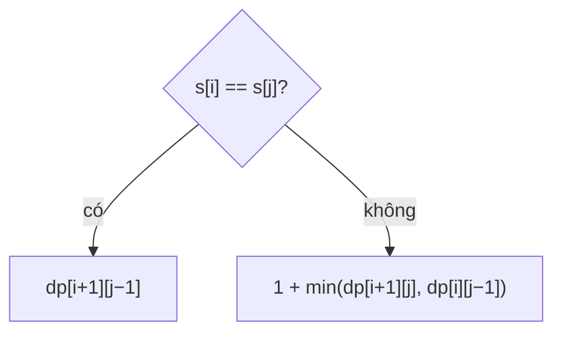

<!-- approaches: Interval DP · n - longest palindromic subsequence -->
# 1312. Minimum Insertion Steps to Make a String Palindrome

**Hard** · String · Dynamic Programming · [LeetCode ↗](https://leetcode.com/problems/minimum-insertion-steps-to-make-a-string-palindrome/) · Code: [MinimumInsertionStepsToMakeAStringPalindrome.java](MinimumInsertionStepsToMakeAStringPalindrome.java) · Tests: [MinimumInsertionStepsToMakeAStringPalindromeTest.java](MinimumInsertionStepsToMakeAStringPalindromeTest.java)

## Đề bài

Chèn **ít ký tự nhất** (ở bất kỳ đâu) để chuỗi trở thành đối xứng.

```
"mbadm" -> 2   ("mbdadbm" hoặc "mbadabm")
```

## Ý tưởng

> Xét đoạn `s[i..j]`:
> - Hai đầu **bằng nhau** → chúng đã đối xứng với nhau, chỉ cần xử lý phần bên trong: `dp[i+1][j−1]`.
> - **Khác nhau** → phải chèn một bản sao của một đầu vào phía bên kia: `1 + min(dp[i+1][j], dp[i][j−1])`.



**Góc nhìn thứ hai:** các ký tự thuộc **dãy con đối xứng dài nhất** (LPS, bài 516) đã tự ghép cặp được; mỗi ký tự còn lại cần **đúng một** ký tự chèn thêm làm cặp. Vậy đáp án = `n − LPS`.

| s | LPS | n − LPS |
|---|---|---|
| mbadm | "mam" hoặc "mdm" (3) | 5 − 3 = **2** |
| leetcode | "eee" (3) | 8 − 3 = **5** |

## Cách 1 — DP khoảng `O(n²)` ⭐

## Cách 2 — `n − LPS` (LPS = LCS với chuỗi đảo) `O(n²) · O(n)`

## Bài liên quan

516 Longest Palindromic Subsequence · 1143 Longest Common Subsequence · 583 Delete Operation for Two Strings · 214 Shortest Palindrome (chỉ chèn vào đầu).
