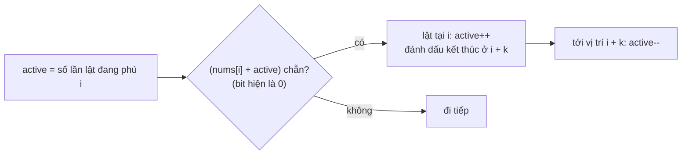

<!-- approaches: Simulate every flip · Greedy with a flip-count difference array · Greedy with in-place markers -->
# 995. Minimum Number of K Consecutive Bit Flips

**Hard** · Array · Bit Manipulation · Queue · Sliding Window · [LeetCode ↗](https://leetcode.com/problems/minimum-number-of-k-consecutive-bit-flips/) · Code: [MinimumNumberOfKConsecutiveBitFlips.java](MinimumNumberOfKConsecutiveBitFlips.java) · Tests: [MinimumNumberOfKConsecutiveBitFlipsTest.java](MinimumNumberOfKConsecutiveBitFlipsTest.java)

## Đề bài

Một lần lật đảo `k` bit **liên tiếp**. Cần ít nhất bao nhiêu lần lật để mọi bit đều là `1`? Không thể → `−1`.

```
[0,0,0,1,0,1,1,0], k = 3 -> 3
  lật 0–2 → [1,1,1,1,0,1,1,0]
  lật 4–6 → [1,1,1,1,1,0,0,0]
  lật 5–7 → [1,1,1,1,1,1,1,1]
```

## Ý tưởng

> Xét bit `0` **trái nhất**: chỉ có **một** lần lật có thể sửa nó mà không phá các bit bên trái đã đúng — lần lật **bắt đầu tại chính nó**. Vậy tham lam: đi từ trái sang, gặp `0` là lật.
> (Thứ tự lật không quan trọng, và lật hai lần cùng chỗ là vô ích → mỗi vị trí bắt đầu lật tối đa một lần — nên tham lam là duy nhất có thể.)

Vấn đề: lật thật `k` bit mỗi lần tốn `O(n·k)`. Chỉ cần biết **bao nhiêu lần lật đang phủ** vị trí `i` (tính **chẵn lẻ**):



| i | nums | active trước | bit hiện tại | lật? |
|---|---|---|---|---|
| 0 | 0 | 0 | 0 | ✓ (kết thúc ở 3) |
| 1 | 0 | 1 | 1 | |
| 2 | 0 | 1 | 1 | |
| 3 | 1 | 0 | 1 | |
| 4 | 0 | 0 | 0 | ✓ (kết thúc ở 7) |
| 5 | 1 | 1 | 0 | ✓ (kết thúc ở 8) |
| 6 | 1 | 2 | 1 | |
| 7 | 0 | 1 | 1 | → **3 lần** |

## Cách 1 — Mô phỏng `O(n·k)`

## Cách 2 — Mảng hiệu cho số lần lật `O(n)` ⭐

Kỹ thuật **mảng hiệu** (difference array): thay vì cập nhật cả đoạn, chỉ ghi "+1 ở đầu, −1 ở cuối".

## Cách 3 — Đánh dấu tại chỗ `O(1)` bộ nhớ

Cộng 2 vào `nums[i]` để đánh dấu "có lần lật bắt đầu ở đây" (không đổi tính chẵn lẻ của bit gốc). Tới vị trí `i + k` thì xem `nums[i]` có dấu không để giảm `active`.

## Bài liên quan

1004 Max Consecutive Ones III · 1094 Car Pooling (mảng hiệu) · 370 Range Addition · 2027 Minimum Moves to Convert String.
