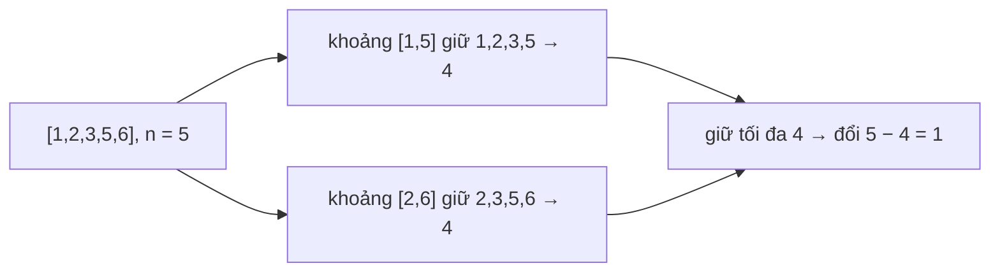

<!-- approaches: Sort + dedupe + sliding window · Sort + binary search per start -->
# 2009. Minimum Number of Operations to Make Array Continuous

**Hard** · Array · Hash Table · Binary Search · Sliding Window · [LeetCode ↗](https://leetcode.com/problems/minimum-number-of-operations-to-make-array-continuous/) · Code: [MinimumNumberOfOperationsToMakeArrayContinuous.java](MinimumNumberOfOperationsToMakeArrayContinuous.java) · Tests: [MinimumNumberOfOperationsToMakeArrayContinuousTest.java](MinimumNumberOfOperationsToMakeArrayContinuousTest.java)

## Đề bài

Mảng dài `n` gọi là **liên tục** nếu các phần tử khác nhau và `max − min = n − 1` (tức là đúng `n` số nguyên liên tiếp). Mỗi thao tác thay một phần tử bằng số bất kỳ. Ít nhất bao nhiêu thao tác?

```
[1,2,3,5,6] -> 1   (đổi 6 thành 4)
```

## Ý tưởng

> Mảng kết quả là một **khoảng** `[x, x + n − 1]`. Ta muốn **giữ lại** nhiều phần tử có sẵn nhất (các số **khác nhau** nằm trong khoảng); các phần tử còn lại (kể cả số trùng) phải thay.
> → Sắp xếp và **khử trùng**, rồi trượt cửa sổ: với mỗi điểm bắt đầu `u[left]`, đếm có bao nhiêu giá trị `≤ u[left] + n − 1`.

Có thể giả định khoảng tốt nhất **bắt đầu tại một giá trị có sẵn**: dời một khoảng sang phải cho tới khi đầu trái chạm một giá trị có sẵn thì không mất phần tử nào.



## Cách 1 — Sắp xếp + khử trùng + cửa sổ trượt `O(n log n)` ⭐

Con trỏ `right` chỉ tiến, không lùi → phần trượt cửa sổ là `O(n)`.

## Cách 2 — Tìm kiếm nhị phân cho mỗi điểm đầu

Với mỗi `left`, tìm nhị phân vị trí đầu tiên vượt `u[left] + n − 1`.

## Bẫy & lưu ý

- Dùng `n` = độ dài **mảng gốc** (không phải số giá trị khác nhau) cho độ rộng khoảng.
- Số trùng **luôn** phải thay — khử trùng tự xử lý điều đó.

## Bài liên quan

1004 Max Consecutive Ones III · 128 Longest Consecutive Sequence · 1838 Frequency of the Most Frequent Element.
