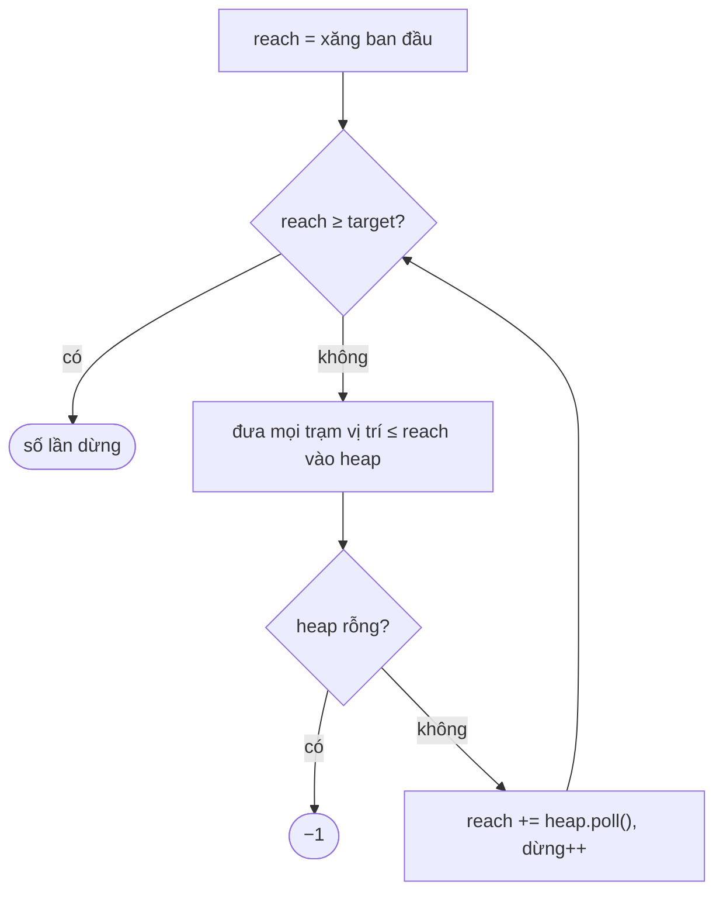

<!-- approaches: Greedy with a max-heap of passed stations · DP over number of stops -->
# 871. Minimum Number of Refueling Stops

**Hard** · Array · Dynamic Programming · Greedy · Heap (Priority Queue) · [LeetCode ↗](https://leetcode.com/problems/minimum-number-of-refueling-stops/) · Code: [MinimumNumberOfRefuelingStops.java](MinimumNumberOfRefuelingStops.java) · Tests: [MinimumNumberOfRefuelingStopsTest.java](MinimumNumberOfRefuelingStopsTest.java)

## Đề bài

Xe xuất phát với `startFuel` lít, đi mỗi dặm tốn 1 lít. Các trạm `[vị trí, lượng xăng]` dọc đường. Cần **ít lần dừng đổ xăng nhất** để tới `target`; không thể → `−1`.

```
target = 100, startFuel = 10, trạm [[10,60],[20,30],[30,30],[60,40]] -> 2    (đổ ở 10 và 60)
```

## Ý tưởng

> **Tham lam có hối hận:** cứ chạy tới khi hết xăng, **ghi nhớ** mọi trạm đã đi qua (max-heap theo lượng xăng). Khi không đi tiếp được, "**quay ngược thời gian**" coi như đã dừng ở trạm **nhiều xăng nhất** đã đi qua — mỗi lần dừng phải được nhiều xăng nhất có thể.



| reach | trạm trong heap | lấy | reach mới |
|---|---|---|---|
| 10 | 60 (vị trí 10) | 60 | 70 |
| 70 | 30, 30, 40 | 40 | 110 ≥ 100 ✓ |

→ **2** lần dừng.

## Cách 1 — Tham lam + max-heap `O(n log n)` ⭐

**Vì sao đúng?** Với `k` lần dừng, quãng đường xa nhất đạt được là khi chọn `k` trạm nhiều xăng nhất **trong số các trạm tới được**. Thuật toán luôn duy trì đúng điều này.

## Cách 2 — DP theo số lần dừng `O(n²)`

`dp[s]` = quãng đường xa nhất với `s` lần dừng. Duyệt từng trạm; nếu `dp[s]` tới được trạm thì `dp[s+1] = max(dp[s+1], dp[s] + xăng)`. Duyệt `s` **ngược** để mỗi trạm chỉ dùng một lần (như knapsack 0/1).

## Bài liên quan

630 Course Schedule III · 1642 Furthest Building You Can Reach · 45 Jump Game II · 134 Gas Station.
