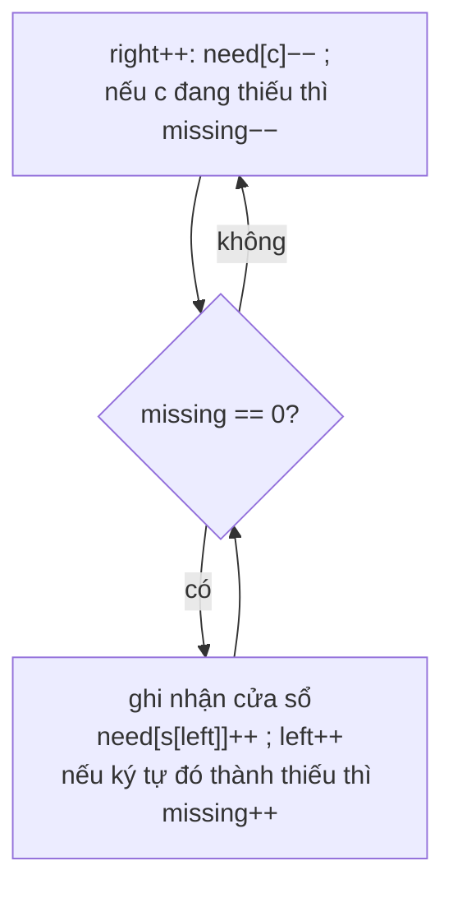

<!-- approaches: Sliding window with a missing counter · Brute force over all windows -->
# 76. Minimum Window Substring

**Hard** · Hash Table · String · Sliding Window · [LeetCode ↗](https://leetcode.com/problems/minimum-window-substring/) · Code: [MinimumWindowSubstring.java](MinimumWindowSubstring.java) · Tests: [MinimumWindowSubstringTest.java](MinimumWindowSubstringTest.java)

## Đề bài

Tìm chuỗi con **ngắn nhất** của `s` chứa **mọi ký tự** của `t` (kể cả số lần lặp). Không có → `""`.

```
s = "ADOBECODEBANC", t = "ABC" -> "BANC"
```

## Ý tưởng

> **Cửa sổ trượt co giãn** (bài sliding window "đinh" nhất):
> 1. Mở rộng `right` cho tới khi cửa sổ chứa đủ `t`.
> 2. Co `left` hết mức trong khi vẫn đủ — mỗi lần đủ thì ghi nhận độ dài.
> 3. Khi co làm thiếu, quay lại bước 1.
> Theo dõi "còn thiếu" bằng mảng `need[c]` và một biến `missing` = tổng số ký tự còn thiếu → kiểm tra "đủ chưa" trong `O(1)`.



`need[c]` có thể **âm**: nghĩa là cửa sổ đang thừa ký tự `c` (hoặc `c` không có trong `t`). Chỉ khi `need[c]` từ `> 0` giảm xuống mới làm giảm `missing`.

| cửa sổ đủ (lần lượt) | độ dài |
|---|---|
| ADOBEC | 6 |
| CODEBA | 6 |
| ANC… → BANC | **4** |

## Cách 1 — Cửa sổ trượt + `missing` `O(m + n)` ⭐

## Cách 2 — Vét cạn

Từ mỗi điểm đầu, mở rộng tới khi đủ. Dùng làm chuẩn để test.

## Bài liên quan

3 Longest Substring Without Repeating Characters · 438 Find All Anagrams · 567 Permutation in String · 727 Minimum Window Subsequence · 30 Substring with Concatenation of All Words.
