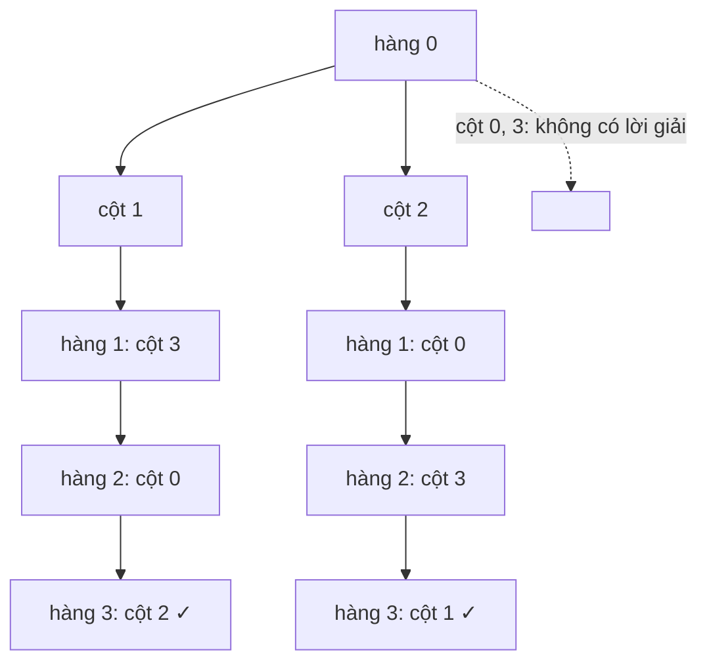

<!-- approaches: Backtracking with boolean arrays · Backtracking with bitmasks -->
# 52. N-Queens II

**Hard** · Backtracking · Algorithm X · [LeetCode ↗](https://leetcode.com/problems/n-queens-ii/) · Code: [NQueensII.java](NQueensII.java) · Tests: [NQueensIITest.java](NQueensIITest.java)

## Đề bài

Có bao nhiêu cách đặt `n` quân hậu lên bàn cờ `n × n` sao cho không quân nào ăn được quân nào?

```
n = 4 -> 2      n = 8 -> 92
```

## Ý tưởng

> Mỗi **hàng** có đúng một hậu → đặt lần lượt từng hàng, chọn cột. Một ô `(r, c)` bị khống chế nếu đã có hậu cùng **cột**, cùng **đường chéo chính** (`r − c` không đổi) hoặc cùng **đường chéo phụ** (`r + c` không đổi).

```
 r - c:              r + c:
  0 -1 -2 -3          0  1  2  3
  1  0 -1 -2          1  2  3  4
  2  1  0 -1          2  3  4  5
  3  2  1  0          3  4  5  6
```



## Cách 1 — Backtracking với 3 mảng boolean ⭐

`cols[c]`, `diag[r − c + n]`, `anti[r + c]` — kiểm tra `O(1)` mỗi ô.

## Cách 2 — Bitmask (nhanh nhất)

Ba số nguyên đánh dấu các cột bị khống chế bởi cột, chéo trái, chéo phải. Sang hàng sau, khống chế chéo **dịch một bit** sang trái/phải. Lấy bit thấp nhất bằng `x & −x`. Không cấp phát mảng, nhanh hơn nhiều lần với `n` lớn.

| n | 4 | 5 | 6 | 7 | 8 | 9 | 10 |
|---|---|---|---|---|---|---|---|
| số cách | 2 | 10 | 4 | 40 | 92 | 352 | 724 |

## Bài liên quan

51 N-Queens (in ra bàn cờ) · 37 Sudoku Solver · 1001 Grid Illumination.
