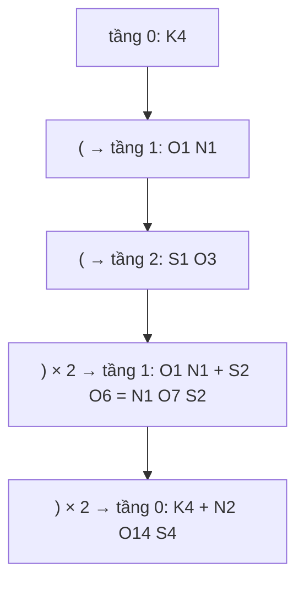

<!-- approaches: Stack of count maps · Recursive descent parser -->
# 726. Number of Atoms

**Hard** · Hash Table · String · Stack · Sorting · [LeetCode ↗](https://leetcode.com/problems/number-of-atoms/) · Code: [NumberOfAtoms.java](NumberOfAtoms.java) · Tests: [NumberOfAtomsTest.java](NumberOfAtomsTest.java)

## Đề bài

Đọc một công thức hoá học (nguyên tố như `H`, `Mg`; số đếm tuỳ chọn; nhóm trong ngoặc có hệ số nhân, có thể lồng nhau) và trả về số lượng từng nguyên tố, sắp xếp theo tên, bỏ số `1`.

```
"Mg(OH)2"       -> "H2MgO2"
"K4(ON(SO3)2)2" -> "K4N2O14S4"
```

## Ý tưởng

> Ngoặc lồng nhau → **stack**. Mỗi tầng ngoặc có một bảng đếm riêng. Gặp `(` thì mở bảng mới; gặp `)k` thì đóng bảng, **nhân mọi số đếm với `k`**, rồi cộng vào bảng của tầng ngoài.

`"K4(ON(SO3)2)2"`:



## Cách 1 — Stack các bảng đếm ⭐

Ba loại token: `(`, `)` + số, và **tên nguyên tố** (một chữ hoa + các chữ thường) + số. Thiếu số nghĩa là 1. Dùng `TreeMap` để kết quả tự sắp xếp theo tên.

## Cách 2 — Đệ quy (recursive descent)

`parse()` đọc tới `)` hoặc hết chuỗi và trả về bảng đếm của nhóm đó; gặp `(` thì gọi đệ quy cho nhóm con. Cùng khuôn với 394 Decode String và các parser biểu thức.

## Bẫy & lưu ý

- Tên nguyên tố có thể dài hai chữ (`Mg`, `He`) — đọc tiếp **chữ thường**.
- Số có thể nhiều chữ số (`Be32`).

## Bài liên quan

394 Decode String · 224 Basic Calculator · 736 Parse Lisp Expression · 1096 Brace Expansion II.
