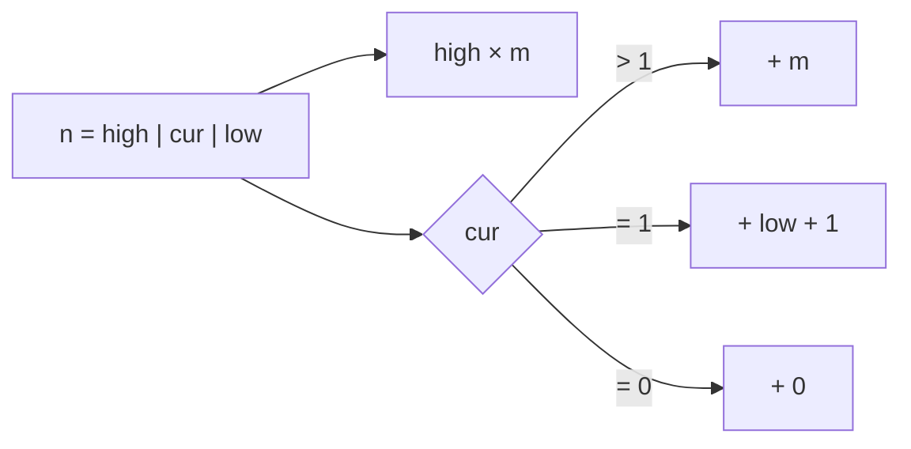

<!-- approaches: Count per decimal position · Digit DP -->
# 233. Number of Digit One

**Hard** · Math · Dynamic Programming · Recursion · [LeetCode ↗](https://leetcode.com/problems/number-of-digit-one/) · Code: [NumberOfDigitOne.java](NumberOfDigitOne.java) · Tests: [NumberOfDigitOneTest.java](NumberOfDigitOneTest.java)

## Đề bài

Đếm **tổng số chữ số 1** xuất hiện trong mọi số nguyên từ `0` tới `n`.

```
13 -> 6    (1, 10, 11, 12, 13: một, một, hai, một, một)
```

## Ý tưởng

> Đếm **theo từng hàng** (đơn vị, chục, trăm…) thay vì theo từng số. Xét hàng có trọng số `m`, tách `n` thành ba phần:
> `high` = các chữ số **bên trái** hàng, `cur` = chữ số **tại** hàng, `low` = các chữ số **bên phải**.
> Hàng này hiện số 1 theo chu kỳ: mỗi `10m` số thì có đúng `m` số mang chữ 1 ở hàng đó.

| trường hợp | số lần chữ 1 ở hàng này |
|---|---|
| luôn có | `high × m` (các chu kỳ đầy đủ) |
| `cur > 1` | thêm `m` (chu kỳ dở dang đã qua hết đoạn có số 1) |
| `cur == 1` | thêm `low + 1` (đang ở giữa đoạn có số 1) |
| `cur == 0` | không thêm |

`n = 13`:

| hàng (m) | high | cur | low | đếm |
|---|---|---|---|---|
| đơn vị (1) | 1 | 3 | 0 | 1·1 + 1 = 2 (1, 11) |
| chục (10) | 0 | 1 | 3 | 0 + 3 + 1 = 4 (10, 11, 12, 13) |
| | | | | **6** |



## Cách 1 — Đếm theo hàng `O(log n)` ⭐

Dùng `long` cho `m` (với `n` gần `2³¹`, `m · 10` vượt `int`).

## Cách 2 — Digit DP

Duyệt từng chữ số của `n` từ trái sang, trạng thái `(vị trí, số chữ 1 đã đặt, còn "bám sát" n không)`. Khuôn **digit DP** tổng quát giải được cả họ bài "đếm số trong `[0, n]` thoả tính chất về chữ số" (233, 357, 600, 902, 1012).

## Bài liên quan

357 Count Numbers with Unique Digits · 902 Numbers At Most N Given Digit Set · 1012 Numbers With Repeated Digits · 172 Factorial Trailing Zeroes.
