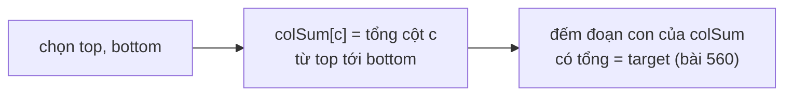

<!-- approaches: Brute force with 2D prefix sums · Fix two rows + subarray-sum hash map -->
# 1074. Number of Submatrices That Sum to Target

**Hard** · Array · Hash Table · Matrix · Prefix Sum · [LeetCode ↗](https://leetcode.com/problems/number-of-submatrices-that-sum-to-target/) · Code: [NumberOfSubmatricesThatSumToTarget.java](NumberOfSubmatricesThatSumToTarget.java) · Tests: [NumberOfSubmatricesThatSumToTargetTest.java](NumberOfSubmatricesThatSumToTargetTest.java)

## Đề bài

Đếm số **ma trận con** (khác rỗng) có tổng phần tử bằng `target`.

```
[[1,-1],[-1,1]], target = 0 -> 5    (hai hàng, hai cột, cả ma trận)
```

## Ý tưởng

> Đưa bài 2D về bài 1D đã biết. **Cố định hàng trên và hàng dưới** → dải hàng đó "ép" thành một mảng các **tổng theo cột**. Mỗi ma trận con trong dải tương ứng với một **đoạn con** của mảng này → đếm đoạn con có tổng bằng `target` (bài 560: prefix sum + HashMap).



Ví dụ `[[1,−1],[−1,1]]`, target 0:

| top–bottom | colSum | đoạn tổng 0 |
|---|---|---|
| 0–0 | [1, −1] | [1, −1] → 1 |
| 1–1 | [−1, 1] | 1 |
| 0–1 | [0, 0] | [0], [0], [0,0] → 3 |
| | | **5** |

Bài 560 nhắc lại: tổng đoạn `(i, j]` = `prefix[j] − prefix[i]`. Muốn bằng `target` → đếm số lần đã gặp `prefix[j] − target`.

## Cách 1 — Prefix sum 2D + duyệt mọi hình chữ nhật `O(m²n²)`

Tổng hình chữ nhật trong `O(1)` bằng công thức bao hàm–loại trừ.

## Cách 2 — Cố định hai hàng + bài 560 `O(m²n)` ⭐

Nếu `m > n`, chuyển vị trước để vòng lặp bình phương chạy trên chiều ngắn hơn.

## Bài liên quan

560 Subarray Sum Equals K · 304 Range Sum Query 2D · 363 Max Sum of Rectangle No Larger Than K · 85 Maximal Rectangle.
