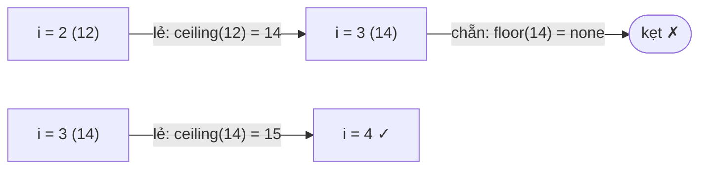

<!-- approaches: TreeMap for next jumps + DP from the right · Sorted indexes + monotonic stack -->
# 975. Odd Even Jump

**Hard** · Array · Dynamic Programming · Stack · Sorting · [LeetCode ↗](https://leetcode.com/problems/odd-even-jump/) · Code: [OddEvenJump.java](OddEvenJump.java) · Tests: [OddEvenJumpTest.java](OddEvenJumpTest.java)

## Đề bài

Từ chỉ số `i`: bước nhảy **lẻ** (1, 3, 5…) tới `j > i` có `arr[j] ≥ arr[i]` **nhỏ nhất** (bằng nhau lấy chỉ số nhỏ nhất); bước nhảy **chẵn** tới `j > i` có `arr[j] ≤ arr[i]` **lớn nhất**. Điểm xuất phát "tốt" nếu nhảy tới được chỉ số cuối. Đếm số điểm tốt.

```
[10,13,12,14,15] -> 2    (chỉ số 3 và 4)
```

## Ý tưởng

> Từ mỗi chỉ số, bước nhảy tiếp theo là **xác định** (chỉ phụ thuộc vào lượt lẻ/chẵn). Nên định nghĩa hai trạng thái:
> - `odd[i]` = bắt đầu ở `i` với bước **lẻ**, có tới đích không;
> - `even[i]` = bắt đầu ở `i` với bước **chẵn**.
> `odd[i] = even[đích bước lẻ từ i]`, `even[i] = odd[đích bước chẵn từ i]`. Tính **từ phải sang trái**; đáp án = số `i` có `odd[i]` đúng (bước đầu tiên luôn là bước lẻ).

Khó khăn còn lại: tìm đích nhảy nhanh. Đi từ phải sang, giữ `TreeMap<giá trị, chỉ số>` các phần tử **bên phải**:
- bước lẻ: `ceilingEntry(arr[i])` (giá trị nhỏ nhất `≥`);
- bước chẵn: `floorEntry(arr[i])` (giá trị lớn nhất `≤`).
Ghi đè khoá trùng bằng chỉ số mới (nhỏ hơn) → tự động thoả luật "chỉ số nhỏ nhất".



## Cách 1 — TreeMap + DP từ phải `O(n log n)` ⭐

## Cách 2 — Sắp xếp chỉ số + stack đơn điệu

Sắp chỉ số theo `(giá trị, chỉ số)`. Đích bước lẻ của `i` = phần tử **đứng sau `i` trong thứ tự này** có chỉ số lớn hơn `i` gần nhất — bài "phần tử lớn hơn tiếp theo" (496) trên dãy chỉ số. Bước chẵn: sắp theo giá trị **giảm dần**.

## Bài liên quan

496 Next Greater Element I · 1340 Jump Game V · 456 132 Pattern · 2398 Maximum Number of Robots Within Budget.
