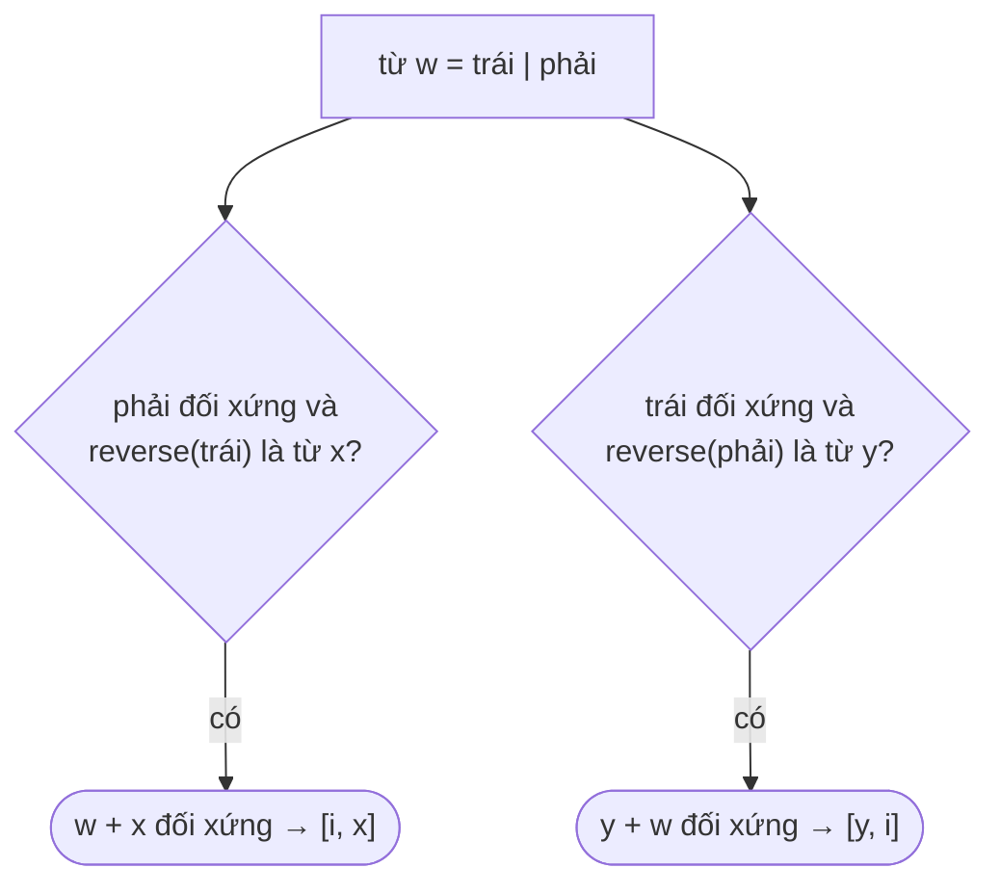

<!-- approaches: Hash map of reversed words checking prefix/suffix splits · Brute force all pairs -->
# 336. Palindrome Pairs

**Hard** · Array · Hash Table · String · Trie · [LeetCode ↗](https://leetcode.com/problems/palindrome-pairs/) · Code: [PalindromePairs.java](PalindromePairs.java) · Tests: [PalindromePairsTest.java](PalindromePairsTest.java)

## Đề bài

Các từ **khác nhau**. Tìm mọi cặp `[i, j]` (`i ≠ j`) sao cho `words[i] + words[j]` là chuỗi đối xứng.

```
["abcd","dcba","lls","s","sssll"] -> [0,1] [1,0] [3,2] [2,4]
   "abcd"+"dcba", "dcba"+"abcd", "s"+"lls" = "slls", "lls"+"sssll" = "llssssll"
```

## Ý tưởng

> Ghép `A + B` đối xứng. Giả sử `A` dài hơn hoặc bằng `B`: cắt `A = trái + phải`, thì `A + B` đối xứng ⇔ **`phải` tự đối xứng** và **`B = reverse(trái)`**. (Trường hợp `B` dài hơn đối xứng tương tự.)
> → Lưu mọi từ **đảo ngược** vào HashMap; với mỗi từ, thử **mọi vị trí cắt** và tra bảng.



`w = "lls"`, cắt `"ll" | "s"`: `trái = "ll"` đối xứng, `reverse("s") = "s"` có trong danh sách → `"s" + "lls" = "slls"` ✓ → cặp `[3, 2]`.

## Cách 1 — Vét cạn mọi cặp `O(n²·L)`

## Cách 2 — HashMap từ đảo ngược + mọi vị trí cắt `O(n·L²)` ⭐

**Bẫy trùng lặp:** cắt ở vị trí `0` (trái rỗng) và vị trí `L` (phải rỗng) có thể phát hiện cùng một cặp từ hai phía → bỏ trường hợp `cut = 0` ở nhánh thứ hai. **Từ rỗng** `""`: ghép với mọi từ đối xứng theo cả hai chiều — test có ca `["a", ""]`.

## Bài liên quan

5 Longest Palindromic Substring · 214 Shortest Palindrome · 1 Two Sum (cùng ý tưởng tra phần bù bằng HashMap) · 2131 Longest Palindrome by Concatenating Two Letter Words.
