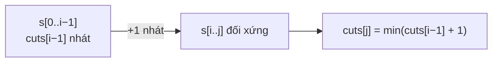

<!-- approaches: Palindrome table + min-cut DP · Expand around centers updating cuts -->
# 132. Palindrome Partitioning II

**Hard** · String · Dynamic Programming · [LeetCode ↗](https://leetcode.com/problems/palindrome-partitioning-ii/) · Code: [PalindromePartitioningII.java](PalindromePartitioningII.java) · Tests: [PalindromePartitioningIITest.java](PalindromePartitioningIITest.java)

## Đề bài

Chia chuỗi thành các đoạn **đều đối xứng** với **ít nhát cắt nhất**.

```
"aab"    -> 1    aa | b
"abccbc" -> 2    a | bccb | c
```

## Ý tưởng

> Bài 131 liệt kê mọi cách chia (lũy thừa); ở đây chỉ cần **số nhát cắt ít nhất** → **DP**.
> `cuts[j]` = số nhát cắt ít nhất cho tiền tố `s[0..j]`. Đoạn **cuối cùng** là một đoạn đối xứng `s[i..j]`:
> - `i = 0` → cả tiền tố đối xứng → `cuts[j] = 0`;
> - ngược lại → `cuts[j] = min(cuts[i−1] + 1)`.

`"aab"`:

| j | tiền tố | đoạn cuối đối xứng có thể | cuts[j] |
|---|---|---|---|
| 0 | a | a | 0 |
| 1 | aa | aa (i = 0) | 0 |
| 2 | aab | b (i = 2) → cuts[1] + 1 | **1** |



## Cách 1 — Bảng đối xứng + DP nhát cắt `O(n²)` ⭐

Tính `isPal[i][j]` **cùng lúc** với `cuts` (khi xét `j`, các `isPal[i+1][j−1]` đã có sẵn từ cột trước).

## Cách 2 — Nở từ tâm, bộ nhớ `O(n)`

Mỗi khi nở được một đoạn đối xứng `s[l..r]` từ một tâm, cập nhật `cuts[r] = min(cuts[r], cuts[l−1] + 1)`. Không cần bảng `n × n`.

## Bài liên quan

131 Palindrome Partitioning · 5 Longest Palindromic Substring · 1278 Palindrome Partitioning III · 1745 Palindrome Partitioning IV.
