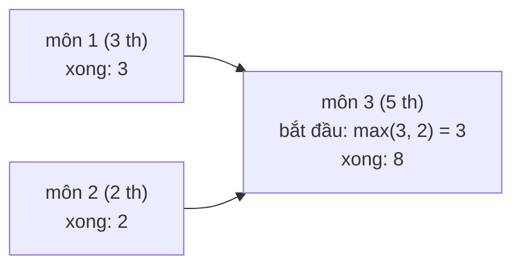

<!-- approaches: Topological order (Kahn) with earliest finish times · DFS with memo on finish time -->
# 2050. Parallel Courses III

**Hard** · Array · Dynamic Programming · Graph Theory · Topological Sort · [LeetCode ↗](https://leetcode.com/problems/parallel-courses-iii/) · Code: [ParallelCoursesIII.java](ParallelCoursesIII.java) · Tests: [ParallelCoursesIIITest.java](ParallelCoursesIIITest.java)

## Đề bài

`n` môn học, môn `i` mất `time[i]` tháng; `[prev, next]` nghĩa là phải xong `prev` mới học được `next`. Học **song song** bao nhiêu môn cũng được. Thời gian ít nhất để xong tất cả?

```
n = 3, [[1,3],[2,3]], time = [3,2,5] -> 8   (môn 1 và 2 song song, xong ở tháng 3; môn 3 thêm 5 tháng)
```

## Ý tưởng

> Môn `c` chỉ bắt đầu được khi **mọi** môn tiên quyết đã xong → `finish(c) = time(c) + max(finish(môn tiên quyết))`.
> Đáp án là `max finish` — độ dài **đường găng** (critical path) trong đồ thị DAG.



## Cách 1 — Sắp xếp tô-pô (Kahn) + thời điểm sớm nhất ⭐

Duyệt theo thứ tự tô-pô (bài 210); khi một môn xong, cập nhật thời điểm bắt đầu sớm nhất của các môn phụ thuộc: `start[d] = max(start[d], finish)`.

| môn | start | finish |
|---|---|---|
| 1 | 0 | 3 |
| 2 | 0 | 2 |
| 3 | max(3, 2) = 3 | **8** |

## Cách 2 — DFS có nhớ

Tính `finish(c)` đệ quy qua các môn tiên quyết, ghi nhớ kết quả. Code ngắn hơn, nhưng đệ quy sâu tới `n` nếu chuỗi phụ thuộc dài.

## Ứng dụng

Lập kế hoạch dự án (phương pháp **CPM** / sơ đồ PERT), build hệ thống với các tác vụ phụ thuộc chạy song song.

## Bài liên quan

210 Course Schedule II · 1136 Parallel Courses (mỗi môn 1 học kỳ) · 1494 Parallel Courses II (giới hạn số môn/kỳ — bitmask DP) · 329 Longest Increasing Path in a Matrix.
