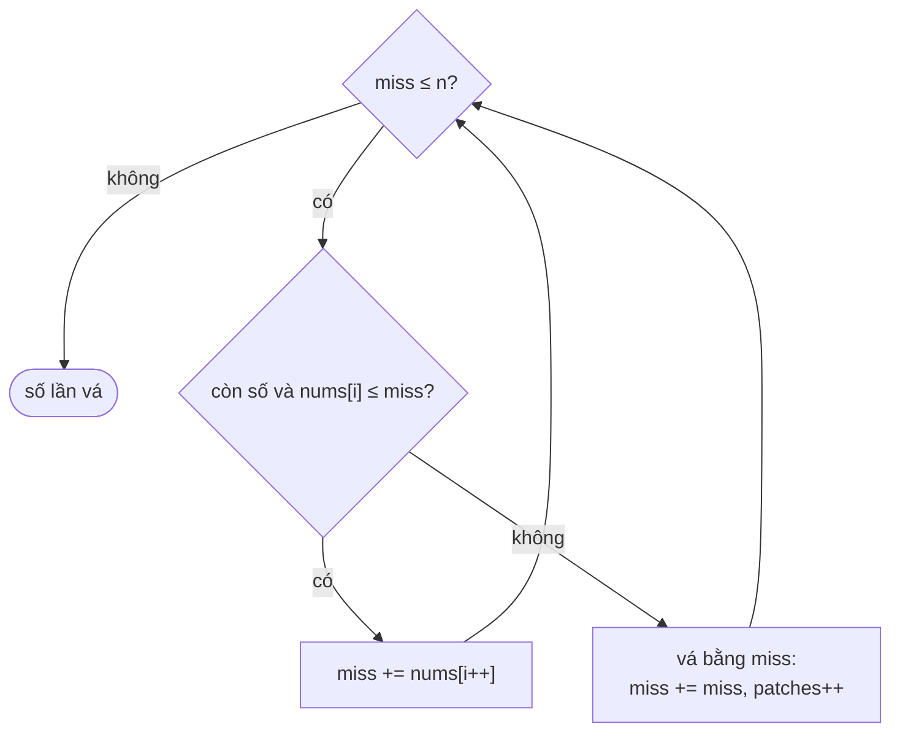

<!-- approaches: Greedy reachable range -->
# 330. Patching Array

**Hard** · Array · Greedy · [LeetCode ↗](https://leetcode.com/problems/patching-array/) · Code: [PatchingArray.java](PatchingArray.java) · Tests: [PatchingArrayTest.java](PatchingArrayTest.java)

## Đề bài

Mảng `nums` đã sắp xếp và số `n`. Thêm **ít số nhất** vào mảng để **mọi** số trong `[1, n]` đều biểu diễn được thành tổng của một vài phần tử.

```
[1,3],    n = 6  -> 1   (thêm 2: tạo được 1..6)
[1,5,10], n = 20 -> 2   (thêm 2 và 4)
```

## Ý tưởng

> Giữ `miss` = **số nhỏ nhất chưa tạo được**; mọi số trong `[1, miss)` đều tạo được.
> - Số tiếp theo `x ≤ miss`: cộng thêm `x` vào mọi tổng cũ → tạo được cả `[1, miss + x)`.
> - `x > miss` (hoặc hết số): **không có cách nào** tạo `miss` từ các số còn lại → phải thêm. Thêm chính `miss` là tốt nhất: số lớn nhất mà khoảng vẫn liền mạch, và **nhân đôi** khoảng thành `[1, 2·miss)`.



`[1, 5, 10], n = 20`:

| miss | số xét | hành động | khoảng tạo được |
|---|---|---|---|
| 1 | 1 | dùng | [1, 2) |
| 2 | 5 > 2 | **vá 2** | [1, 4) |
| 4 | 5 > 4 | **vá 4** | [1, 8) |
| 8 | 5 | dùng | [1, 13) |
| 13 | 10 | dùng | [1, 23) ⊇ [1, 20] ✓ |

## Lời giải — Tham lam `O(len + log n)` ⭐

Mỗi lần vá nhân đôi `miss` → tối đa ~31 lần vá với `n ≤ 2³¹`. Dùng `long` cho `miss` để không tràn.

**Vì sao tối ưu?** Khi `miss` không tạo được, bắt buộc phải thêm một số `≤ miss`. Số lớn nhất có thể (`miss`) mở rộng khoảng nhiều nhất, và mọi lựa chọn khác chỉ cho khoảng nhỏ hơn — không bao giờ có lợi hơn về sau. Test so với vét cạn trên dữ liệu nhỏ.

## Bài liên quan

1798 Maximum Number of Consecutive Values You Can Make · 2952 Minimum Number of Coins to be Added · 55 Jump Game (cùng kiểu "nới tầm với").
