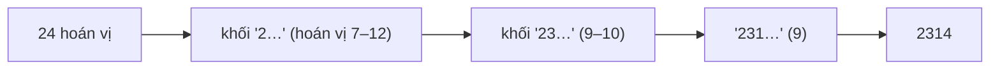

<!-- approaches: Factorial number system · Next permutation k - 1 times -->
# 60. Permutation Sequence

**Hard** · Math · Recursion · [LeetCode ↗](https://leetcode.com/problems/permutation-sequence/) · Code: [PermutationSequence.java](PermutationSequence.java) · Tests: [PermutationSequenceTest.java](PermutationSequenceTest.java)

## Đề bài

Liệt kê `n!` hoán vị của `1…n` theo thứ tự từ điển; trả về hoán vị **thứ k**.

```
n = 3:  123, 132, 213, 231, 312, 321     -> k = 3 là "213"
```

## Ý tưởng

> Không cần sinh `k − 1` hoán vị trước. Các hoán vị chia thành **khối**: mỗi lựa chọn chữ số đầu tiên chiếm đúng `(n−1)!` hoán vị.
> → chữ số đầu = chữ số chưa dùng thứ `⌊(k−1) / (n−1)!⌋`; phần dư cho biết vị trí **bên trong** khối, lặp lại với `n − 1` chữ số còn lại.

Đây là **hệ cơ số giai thừa** (factorial number system).

`n = 4, k = 9` → hạng 0-based = 8:

| bước | còn lại | khối (n−1)! | chỉ số = 8 / khối | chọn | dư |
|---|---|---|---|---|---|
| 1 | 1 2 3 4 | 6 | 1 | **2** | 2 |
| 2 | 1 3 4 | 2 | 1 | **3** | 0 |
| 3 | 1 4 | 1 | 0 | **1** | 0 |
| 4 | 4 | 1 | 0 | **4** | |



## Cách 1 — Hệ cơ số giai thừa `O(n²)` ⭐

Nhớ chuyển `k` về **0-based** (`k − 1`) trước khi chia.

## Cách 2 — "Next permutation" `k − 1` lần

Dùng thuật toán bài 31. Đúng, nhưng `k` có thể tới `9! = 362 880` — chậm hơn nhiều; dùng làm chuẩn để test.

## Bài liên quan

31 Next Permutation · 46 Permutations · 1830 Minimum Number of Operations to Make String Sorted (xếp hạng hoán vị).
