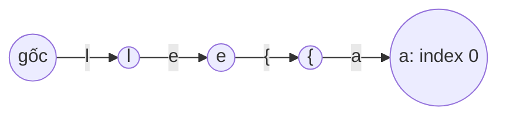

<!-- approaches: Trie of 'suffix#word' keys · Hash map of every (prefix, suffix) pair -->
# 745. Prefix and Suffix Search

**Hard** · Array · Hash Table · String · Design · [LeetCode ↗](https://leetcode.com/problems/prefix-and-suffix-search/) · Code: [PrefixAndSuffixSearch.java](PrefixAndSuffixSearch.java) · Tests: [PrefixAndSuffixSearchTest.java](PrefixAndSuffixSearchTest.java)

## Đề bài

`WordFilter(words)`; `f(pref, suff)` trả về **chỉ số lớn nhất** của từ có tiền tố `pref` **và** hậu tố `suff`, không có → `−1`.

```
words = ["apple", "ape", "banana"]
f("a", "e") -> 1 (ape)        f("b", "na") -> 2
```

## Ý tưởng

> Trie chỉ trả lời được câu hỏi **tiền tố**. Mẹo: biến điều kiện "tiền tố + hậu tố" thành **một tiền tố duy nhất** bằng cách ghép chuỗi:
> với mỗi từ `w`, chèn vào Trie mọi chuỗi `hậu_tố + "{" + w` (ký tự `{` đứng ngay sau `z` trong bảng mã, dùng làm dấu phân cách).
> Truy vấn `f(pref, suff)` = đi theo `suff + "{" + pref`.

`"apple"` chèn các khoá:

```
"{apple"   "e{apple"   "le{apple"   "ple{apple"   "pple{apple"   "apple{apple"
```

`f("a", "le")` đi theo `"le{a"` → là tiền tố của `"le{apple"` ✓.



Mỗi node lưu **chỉ số lớn nhất** của từ đi qua nó (chèn theo thứ tự chỉ số tăng, ghi đè là được).

## Cách 1 — Trie khoá `hậu_tố{từ` ⭐

Dựng: `O(N · L²)`; truy vấn: `O(|pref| + |suff|)`.

## Cách 2 — HashMap mọi cặp (tiền tố, hậu tố)

Từ dài tối đa 7 → mỗi từ chỉ có `8 × 8 = 64` cặp. Đưa hết vào HashMap, truy vấn `O(1)`. Đơn giản và nhanh — đáng nói ra khi ràng buộc nhỏ như vậy.

## Bài liên quan

208 Implement Trie · 211 Design Add and Search Words · 1032 Stream of Characters · 336 Palindrome Pairs.
