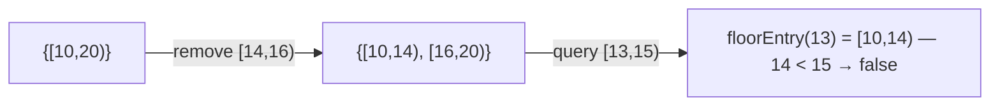

<!-- approaches: TreeMap of disjoint intervals · Sorted list of boundaries -->
# 715. Range Module

**Hard** · Design · Segment Tree · Ordered Set · [LeetCode ↗](https://leetcode.com/problems/range-module/) · Code: [RangeModule.java](RangeModule.java) · Tests: [RangeModuleTest.java](RangeModuleTest.java)

## Đề bài

Theo dõi các khoảng nửa mở `[left, right)`: `addRange` thêm, `removeRange` xoá, `queryRange` hỏi **mọi** số trong khoảng có đang được theo dõi không.

```
add [10,20) · remove [14,16)
query [10,14) -> true · query [13,15) -> false · query [16,17) -> true
```

## Ý tưởng

> Lưu các khoảng **rời nhau, không chạm nhau** trong `TreeMap<start, end>`. Mọi thao tác chỉ ảnh hưởng tới các khoảng **giao** với `[left, right)` — tìm được nhanh bằng `floorEntry` / `ceilingEntry`.



| thao tác | việc làm |
|---|---|
| **add** | nếu khoảng ngay trước chạm/chồng `left` thì mở rộng từ nó; nuốt mọi khoảng bắt đầu trong `[left, right]` |
| **remove** | cắt khoảng bắt đầu trước `left` (giữ phần trái, có thể để lại phần phải sau `right`); xoá/cắt mọi khoảng bắt đầu trong `[left, right)` |
| **query** | `floorEntry(left)` phải tồn tại và kết thúc `≥ right` (các khoảng không chạm nhau nên chỉ một khoảng có thể phủ) |

## Cách 1 — `TreeMap` các khoảng ⭐

Mỗi thao tác `O(log n + số khoảng bị gộp/xoá)` — khấu hao `O(log n)` vì mỗi khoảng được tạo ra rồi xoá đi tối đa một lần.

## Cách 2 — Danh sách các mốc biên

Lưu `[s0, e0, s1, e1, …]` đã sắp xếp: một điểm `x` nằm trong vùng theo dõi ⇔ số mốc `≤ x` là **lẻ**. Thêm/xoá = thay đoạn mốc trong `[left, right]` bằng 0–2 mốc mới. Gọn, nhưng chèn/xoá giữa danh sách tốn `O(n)`.

## Bài liên quan

352 Data Stream as Disjoint Intervals · 57 Insert Interval · 729 My Calendar I · 2276 Count Integers in Intervals.
