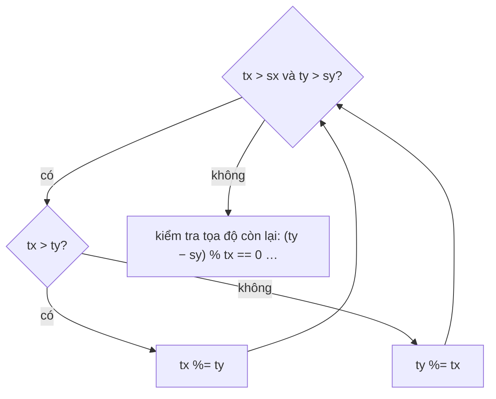

<!-- approaches: Work backwards with modulo -->
# 780. Reaching Points

**Hard** · Math · Euclidean Algorithm · Greatest Common Divisor · [LeetCode ↗](https://leetcode.com/problems/reaching-points/) · Code: [ReachingPoints.java](ReachingPoints.java) · Tests: [ReachingPointsTest.java](ReachingPointsTest.java)

## Đề bài

Từ điểm `(x, y)` được đi tới `(x, x + y)` hoặc `(x + y, y)`. Từ `(sx, sy)` có tới được `(tx, ty)` không? Mọi giá trị `≥ 1`.

```
(1,1) → (1,2) → (3,2) → (3,5)   -> true
```

## Ý tưởng — đi ngược

> Đi xuôi mỗi điểm có **hai** con → cây nhị phân bùng nổ. Đi **ngược** thì mỗi điểm có **đúng một** cha: tọa độ lớn hơn chắc chắn là tổng vừa được cộng → trừ đi tọa độ nhỏ hơn.
> Trừ lặp lại nhiều lần = **phép chia lấy dư** (giống thuật toán Euclid) → `O(log max)` thay vì `O(max)`.

```
(3,5) → (3,2) → (1,2) → (1,1) ✓
```



## Lời giải `O(log max)` ⭐

**Bẫy:** modulo có thể "trừ lố" qua điểm xuất phát. Vì vậy khi một tọa độ đã bằng điểm xuất phát (ví dụ `tx == sx`), tọa độ kia chỉ còn giảm theo bước `tx` → kiểm tra `(ty − sy) % tx == 0`. Test vét cạn mọi điểm nhỏ bằng tìm kiếm xuôi.

## Bài liên quan

365 Water and Jug Problem · 2543 Check if Point Is Reachable (Hard) · Thuật toán Euclid.
