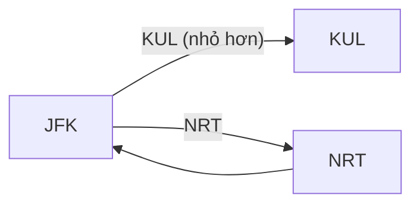

<!-- approaches: Hierholzer with min-heaps (Eulerian path) · Backtracking in lexical order -->
# 332. Reconstruct Itinerary

**Hard** · Array · String · Depth-First Search · Graph Theory · [LeetCode ↗](https://leetcode.com/problems/reconstruct-itinerary/) · Code: [ReconstructItinerary.java](ReconstructItinerary.java) · Tests: [ReconstructItineraryTest.java](ReconstructItineraryTest.java)

## Đề bài

Dùng **mọi** vé `[đi, đến]` đúng một lần để lập hành trình bắt đầu từ `"JFK"`. Có nhiều hành trình thì chọn hành trình **nhỏ nhất theo thứ tự từ điển**.

```
[JFK→SFO, JFK→ATL, SFO→ATL, ATL→JFK, ATL→SFO]
-> JFK, ATL, JFK, SFO, ATL, SFO
```

## Ý tưởng

> Mỗi vé là một **cạnh có hướng**; dùng mọi cạnh đúng một lần = **đường đi Euler**.
> **Thuật toán Hierholzer:** từ sân bay hiện tại, luôn đi theo vé **nhỏ nhất** chưa dùng; khi **bị kẹt** (hết vé), thêm sân bay đó vào **đầu** kết quả (hậu thứ tự). Nhờ vậy, những "ngõ cụt" tự động bị đẩy về **cuối** hành trình.

`JFK → KUL, JFK → NRT, NRT → JFK`:



| bước | đang ở | việc làm | kết quả (từ cuối) |
|---|---|---|---|
| 1 | JFK | đi KUL (nhỏ nhất) | |
| 2 | KUL | kẹt → thêm KUL | KUL |
| 3 | JFK | còn vé NRT → đi | KUL |
| 4 | NRT | đi JFK | KUL |
| 5 | JFK | kẹt → thêm | JFK, KUL |
| 6 | NRT, JFK | lần lượt thêm | **JFK, NRT, JFK, KUL** |

Đi tham lam "KUL trước" là ngõ cụt — nhưng nhờ hậu thứ tự, KUL nằm cuối, đúng như mong muốn.

## Cách 1 — Hierholzer + min-heap `O(E log E)` ⭐

## Cách 2 — Backtracking theo thứ tự từ điển

Thử điểm đến theo thứ tự tăng dần; hành trình đầy đủ **đầu tiên** tìm được là nhỏ nhất. Dễ hiểu nhưng có thể quay lui nhiều.

## Bài liên quan

753 Cracking the Safe (chu trình Euler) · 2097 Valid Arrangement of Pairs · 1971 Find if Path Exists in Graph.
