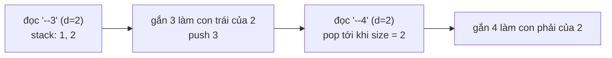

<!-- approaches: Iterative with a stack of the current path · Recursive descent -->
# 1028. Recover a Tree From Preorder Traversal

**Hard** · String · Tree · Depth-First Search · Binary Tree · [LeetCode ↗](https://leetcode.com/problems/recover-a-tree-from-preorder-traversal/) · Code: [RecoverATreeFromPreorderTraversal.java](RecoverATreeFromPreorderTraversal.java) · Tests: [RecoverATreeFromPreorderTraversalTest.java](RecoverATreeFromPreorderTraversalTest.java)

## Đề bài

Một lần duyệt **preorder** in mỗi node thành `D` dấu gạch (độ sâu) rồi tới giá trị. Nếu node chỉ có một con thì đó là con **trái**. Dựng lại cây.

```
"1-2--3--4-5--6--7"   ->        1
                              /   \
                             2     5
                            / \   / \
                           3   4 6   7
```

## Ý tưởng

> Trong preorder, cha của một node ở độ sâu `d` luôn là node **gần nhất trước nó** có độ sâu `d − 1`. Giữ **đường đi từ gốc tới node vừa đọc** trong một stack: stack có đúng `d` phần tử thì đỉnh stack là cha.



| token | depth | pop | gắn vào | stack sau |
|---|---|---|---|---|
| 1 | 0 | | gốc | 1 |
| -2 | 1 | | 1.left | 1 2 |
| --3 | 2 | | 2.left | 1 2 3 |
| --4 | 2 | 3 | 2.right | 1 2 4 |
| -5 | 1 | 4, 2 | 1.right | 1 5 |
| --6 | 2 | | 5.left | 1 5 6 |
| --7 | 2 | 6 | 5.right | 1 5 7 |

## Cách 1 — Stack đường đi `O(n)` ⭐

Con trái được gắn trước (vì preorder thăm trái trước); nếu `left` đã có thì gắn vào `right`.

## Cách 2 — Đệ quy (recursive descent)

`build(depth)` chỉ "ăn" token tiếp theo nếu nó có **đúng** `depth` dấu gạch; ít hơn nghĩa là node đó thuộc tầng cao hơn → trả `null` để quay lên. Con phải chỉ được thử khi đã có con trái.

## Bẫy & lưu ý

- Giá trị có thể nhiều chữ số (`401`).
- Đây là bài parse chuỗi + cấu trúc cây — giống 297 Serialize and Deserialize Binary Tree.

## Bài liên quan

297 Serialize and Deserialize Binary Tree · 105 Construct Binary Tree from Preorder and Inorder · 331 Verify Preorder Serialization of a Binary Tree.
