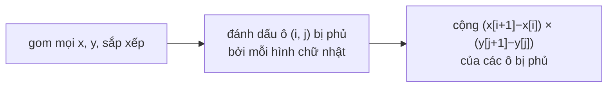

<!-- approaches: Coordinate compression grid · Sweep line over x with active y-intervals -->
# 850. Rectangle Area II

**Hard** · Array · Segment Tree · Sweep Line · Ordered Set · [LeetCode ↗](https://leetcode.com/problems/rectangle-area-ii/) · Code: [RectangleAreaII.java](RectangleAreaII.java) · Tests: [RectangleAreaIITest.java](RectangleAreaIITest.java)

## Đề bài

Cho các hình chữ nhật song song trục `[x1, y1, x2, y2]`. Tính diện tích **phần hợp** (chỗ chồng nhau chỉ tính một lần), `mod 10⁹+7`.

```
[[0,0,2,2],[1,0,2,3],[1,0,3,1]] -> 6
```

## Ý tưởng

> Toạ độ tới 10⁹ nên không thể tô từng ô đơn vị. Nhưng chỉ có tối đa `2n` toạ độ x và `2n` toạ độ y **thực sự xuất hiện** — chúng cắt mặt phẳng thành một lưới **không đều** tối đa `2n × 2n` ô. Mỗi ô hoặc được phủ hoàn toàn, hoặc không → **nén toạ độ**.

```
 y
 3 ┤   ┌─┐
 2 ┼─┬─┤ │          các đường x = 0,1,2,3 và y = 0,1,2,3
 1 │ │ ├─┼─┐        cắt thành lưới 3×3 ô có kích thước khác nhau
 0 ┴─┴─┴─┴─┘
   0 1 2 3  x
```



## Cách 1 — Nén toạ độ + lưới `O(n³)` ⭐ (dễ đúng)

Dùng `long` cho diện tích — tích hai cạnh có thể tới 10¹⁸.

## Cách 2 — Đường quét (sweep line)

Quét một đường thẳng đứng từ trái sang phải. Sự kiện: mép trái (mở khoảng `[y1, y2]`) và mép phải (đóng). Giữa hai sự kiện liên tiếp, diện tích được phủ = **tổng độ dài hợp các khoảng y đang mở** × `Δx`. Độ dài hợp tính bằng gộp khoảng (bài 56). Dùng **segment tree** cho phần này thì đạt `O(n log n)` — đó là lời giải cho dữ liệu lớn.

## Bài liên quan

223 Rectangle Area (hai hình) · 56 Merge Intervals · 218 The Skyline Problem (đường quét) · 391 Perfect Rectangle.
