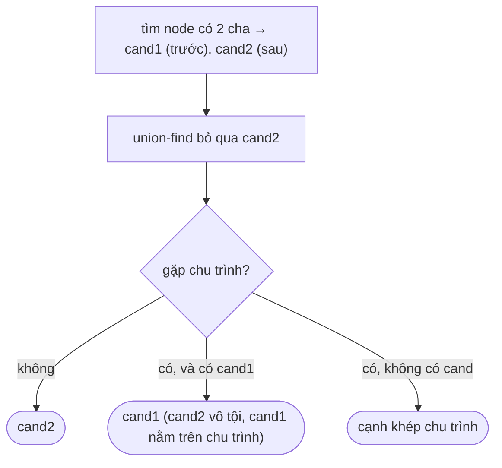

<!-- approaches: Find the double-parent candidates, then union-find -->
# 685. Redundant Connection II

**Hard** · Depth-First Search · Breadth-First Search · Union-Find · Graph Theory · [LeetCode ↗](https://leetcode.com/problems/redundant-connection-ii/) · Code: [RedundantConnectionII.java](RedundantConnectionII.java) · Tests: [RedundantConnectionIITest.java](RedundantConnectionIITest.java)

## Đề bài

Một cây có gốc (cạnh có hướng cha → con) trên các node `1…n` bị thêm **một cạnh có hướng**. Tìm cạnh cần bỏ để còn lại cây có gốc; nhiều đáp án thì lấy cạnh **xuất hiện sau cùng**.

```
[[1,2],[2,3],[3,4],[4,1],[1,5]] -> [4,1]
```

## Ý tưởng — ba trường hợp

> Cạnh thừa gây ra một trong ba tình huống:
> 1. **Một node có hai cha** (không có chu trình) — ví dụ `[[1,2],[1,3],[2,3]]`.
> 2. **Chu trình** (không node nào có hai cha) — cạnh thừa trỏ vào gốc.
> 3. **Cả hai**: một node có hai cha **và** một trong hai cạnh đó nằm trên chu trình.



Thử **bỏ `cand2`** trước (vì ưu tiên cạnh sau). Nếu phần còn lại hết vấn đề → `cand2`. Nếu vẫn còn chu trình → bỏ `cand2` là sai, đáp án phải là `cand1`.

## Lời giải `O(n·α)` ⭐

Test sinh cây ngẫu nhiên, thêm một cạnh, xáo trộn, rồi so với vét cạn "thử bỏ từng cạnh từ cuối lên, kiểm tra còn lại là cây có gốc".

## Bài liên quan

684 Redundant Connection (vô hướng) · 1361 Validate Binary Tree Nodes · 261 Graph Valid Tree · 1579 Remove Max Number of Edges to Keep Graph Fully Traversable.
